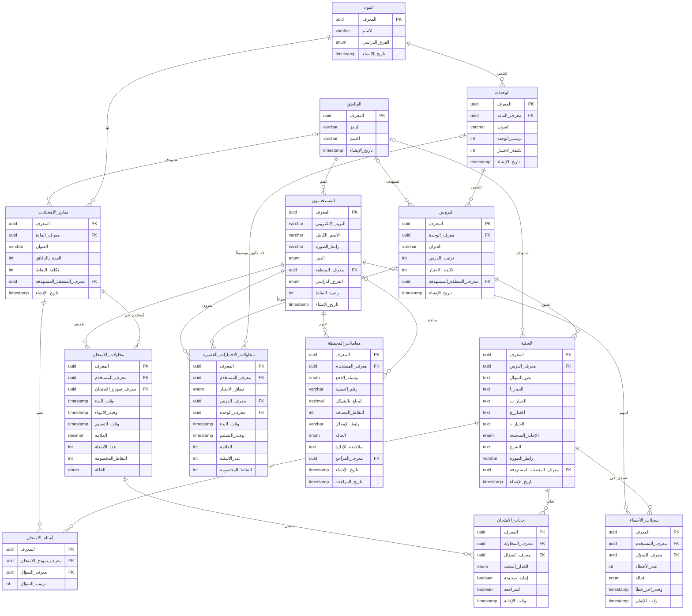

# مخطط الكيانات والعلاقات — سند توجيهي (MVP)

يوثق هذا الملف مخطط قاعدة البيانات المحدّث. أسماء الجداول والحقول في مخطط العلاقات مكتوبة بالعربية، ويعرض قسم DBML الأسماء التقنية كما يجب أن تكون في قاعدة البيانات ويمكن نسخه إلى [dbdiagram.io](https://dbdiagram.io).

## 1. نظرة عامة

يشمل التصميم المناطق والمستخدمين وأدوارهم، والمنهاج وأسئلته، والامتحانات الشاملة ومحاولاتها، والاختبارات القصيرة ومحاولاتها، ودفتر الأخطاء، ومحفظة النقاط ومعاملات الشحن.

## 2. مخطط العلاقات بالعربية



## 3. تعريفات DBML

يتضمن DBML القيود والفهارس والقيم الافتراضية والتعدادات. جدول `quiz_attempts` مطلوب لحفظ محاولات كويزات الدروس والوحدات. محاولات الزائر المجانية تحفظ محلياً وفق PRD. يحتوي MVP على ستة سجلات مواد مستقلة: الرياضيات واللغة الإنجليزية واللغة العربية لكل فرع، مع شجرة محتوى مستقلة لكل سجل.

```dbml
Enum user_role {
  student
  admin
}

Enum stream_type {
  scientific
  literary
}

Enum correct_option_type {
  A
  B
  C
  D
}

Enum attempt_status {
  in_progress
  completed
  expired
  cancelled
}

Enum mistake_status {
  active
  mastered
}

Enum payment_method_type {
  jawwal_pay
  palpay
  bop
}

Enum wallet_status {
  pending
  approved
  rejected
}

Enum quiz_scope {
  lesson
  unit
}

Table regions {
  id uuid [pk, default: `gen_random_uuid()`]
  code varchar(20) [not null, unique, note: 'west_bank / gaza']
  name varchar(100) [not null, unique]
  created_at timestamp [not null, default: `now()`]
}

Table users {
  id uuid [pk, default: `gen_random_uuid()`]
  email varchar(255) [not null, unique]
  full_name varchar(150)
  avatar_url varchar(500)
  role user_role [not null, default: 'student']
  region_id uuid [not null]
  stream stream_type
  points_balance int [not null, default: 0, note: 'CHECK (points_balance >= 0). Changed only on the server']
  created_at timestamp [not null, default: `now()`]
}

Table subjects {
  id uuid [pk, default: `gen_random_uuid()`]
  name varchar(100) [not null]
  stream stream_type [not null]
  created_at timestamp [not null, default: `now()`]

  indexes {
    (name, stream) [unique]
  }

  Note: 'MVP has six separate subject records: Mathematics, English, and Arabic for each stream, with independent content trees.'
}

Table units {
  id uuid [pk, default: `gen_random_uuid()`]
  subject_id uuid [not null]
  title varchar(200) [not null]
  order_index int [not null]
  points_cost int [not null, default: 20, note: 'unit quiz price']
  created_at timestamp [not null, default: `now()`]
}

Table lessons {
  id uuid [pk, default: `gen_random_uuid()`]
  unit_id uuid [not null]
  title varchar(200) [not null]
  order_index int [not null, note: 'Unique within each unit; first two lessons are free by order and this is not stored']
  points_cost int [not null, default: 10, note: 'lesson quiz price']
  target_region_id uuid [note: 'null means all regions']
  created_at timestamp [not null, default: `now()`]

  indexes {
    (unit_id, order_index) [unique]
  }
}

Table questions {
  id uuid [pk, default: `gen_random_uuid()`]
  lesson_id uuid [not null]
  question_text text [not null]
  option_a text [not null]
  option_b text [not null]
  option_c text [not null]
  option_d text [not null]
  correct_option correct_option_type [not null]
  explanation text [not null]
  image_url varchar(500)
  target_region_id uuid [note: 'null means all regions']
  created_at timestamp [not null, default: `now()`]
}

Table exam_templates {
  id uuid [pk, default: `gen_random_uuid()`]
  subject_id uuid [not null]
  title varchar(200) [not null]
  duration_minutes int [not null, default: 60]
  points_cost int [not null, default: 30]
  target_region_id uuid [note: 'null means all regions']
  created_at timestamp [not null, default: `now()`]
}

Table exam_questions {
  id uuid [pk, default: `gen_random_uuid()`]
  exam_template_id uuid [not null]
  question_id uuid [not null]
  question_order int [not null]

  indexes {
    (exam_template_id, question_id) [unique]
  }
}

Table exam_attempts {
  id uuid [pk, default: `gen_random_uuid()`, note: 'exam session id']
  user_id uuid [not null]
  exam_template_id uuid [not null]
  started_at timestamp [not null]
  ends_at timestamp [not null, note: 'started_at + duration, calculated on the server']
  submitted_at timestamp
  score decimal(5,2) [note: 'percentage 0-100']
  total_questions int [not null]
  points_spent int [not null, note: 'price at the time of the attempt']
  status attempt_status [not null, default: 'in_progress']

  indexes {
    (user_id, exam_template_id, status)
    (user_id, status)
  }

  Note: 'Enforce a partial unique constraint on (user_id, exam_template_id) where status = in_progress. Resuming an existing in_progress attempt does not create an attempt or deduct points.'
}

Table exam_answers {
  id uuid [pk, default: `gen_random_uuid()`]
  exam_attempt_id uuid [not null]
  question_id uuid [not null]
  selected_option correct_option_type
  is_correct boolean
  is_flagged boolean [not null, default: false, note: 'marked for review']
  answered_at timestamp

  indexes {
    (exam_attempt_id, question_id) [unique]
  }
}

Table quiz_attempts {
  id uuid [pk, default: `gen_random_uuid()`]
  user_id uuid [not null]
  quiz_type quiz_scope [not null]
  lesson_id uuid
  unit_id uuid
  started_at timestamp [not null]
  submitted_at timestamp
  score int
  total_questions int [not null]
  points_spent int [not null, default: 0, note: '0 for free lessons']

  checks {
    `(quiz_type = 'lesson' AND lesson_id IS NOT NULL AND unit_id IS NULL) OR (quiz_type = 'unit' AND unit_id IS NOT NULL AND lesson_id IS NULL)` [name: 'quiz_attempt_scope_matches_type']
  }

  Note: 'Required: every quiz attempt is stored. Paid attempts deduct the applicable cost per attempt; free guest attempts are stored locally.'
}

Table mistake_entries {
  id uuid [pk, default: `gen_random_uuid()`]
  user_id uuid [not null]
  question_id uuid [not null]
  error_count int [not null, default: 1]
  status mistake_status [not null, default: 'active']
  last_failed_at timestamp [not null]
  mastered_at timestamp

  indexes {
    (user_id, question_id) [unique]
    (user_id, status)
  }
}

Table wallet_transactions {
  id uuid [pk, default: `gen_random_uuid()`]
  user_id uuid [not null]
  payment_method payment_method_type [not null]
  transaction_id varchar(100) [not null]
  amount_ils decimal(10,2) [not null, note: 'CHECK (amount_ils > 0)']
  points_credited int [note: 'null until approved']
  receipt_url varchar(500)
  status wallet_status [not null, default: 'pending']
  admin_note text [note: 'required when rejected']
  reviewed_by uuid [note: 'admin user']
  created_at timestamp [not null, default: `now()`]
  reviewed_at timestamp

  Note: 'A rejected request is corrected and resubmitted by updating this same record, preserving its id.'

  indexes {
    (payment_method, transaction_id) [unique]
    (status, created_at)
  }
}

Ref: users.region_id > regions.id
Ref: lessons.target_region_id > regions.id
Ref: questions.target_region_id > regions.id
Ref: exam_templates.target_region_id > regions.id
Ref: units.subject_id > subjects.id
Ref: lessons.unit_id > units.id
Ref: questions.lesson_id > lessons.id
Ref: exam_templates.subject_id > subjects.id
Ref: exam_questions.exam_template_id > exam_templates.id
Ref: exam_questions.question_id > questions.id
Ref: exam_attempts.user_id > users.id
Ref: exam_attempts.exam_template_id > exam_templates.id
Ref: exam_answers.exam_attempt_id > exam_attempts.id
Ref: exam_answers.question_id > questions.id
Ref: quiz_attempts.user_id > users.id
Ref: quiz_attempts.lesson_id > lessons.id
Ref: quiz_attempts.unit_id > units.id
Ref: mistake_entries.user_id > users.id
Ref: mistake_entries.question_id > questions.id
Ref: wallet_transactions.user_id > users.id
Ref: wallet_transactions.reviewed_by > users.id
```

## 4. أسماء الجداول والحقول بالعربية

| الجدول | الحقول |
|---|---|
| المناطق (`regions`) | المعرّف، الرمز، الاسم، تاريخ الإنشاء. |
| المستخدمون (`users`) | المعرّف، البريد الإلكتروني، الاسم الكامل، رابط الصورة، الدور، معرّف المنطقة، الفرع الدراسي، رصيد النقاط، تاريخ الإنشاء. |
| المواد (`subjects`) | المعرّف، الاسم، الفرع الدراسي، تاريخ الإنشاء. |
| الوحدات (`units`) | المعرّف، معرّف المادة، العنوان، ترتيب الوحدة، تكلفة اختبار الوحدة، تاريخ الإنشاء. |
| الدروس (`lessons`) | المعرّف، معرّف الوحدة، العنوان، ترتيب الدرس (فريد داخل الوحدة)، تكلفة اختبار الدرس، معرّف المنطقة المستهدفة، تاريخ الإنشاء. مجانية أول درسين مشتقة من الترتيب وليست حقلاً مخزناً. |
| الأسئلة (`questions`) | المعرّف، معرّف الدرس، نص السؤال، الخيارات أ/ب/ج/د، الإجابة الصحيحة، الشرح، رابط الصورة، معرّف المنطقة المستهدفة، تاريخ الإنشاء. |
| نماذج الامتحانات (`exam_templates`) | المعرّف، معرّف المادة، العنوان، المدة بالدقائق، تكلفة النقاط، معرّف المنطقة المستهدفة، تاريخ الإنشاء. |
| أسئلة الامتحان (`exam_questions`) | المعرّف، معرّف نموذج الامتحان، معرّف السؤال، ترتيب السؤال. لا يتكرر السؤال نفسه في النموذج نفسه. |
| محاولات الامتحان (`exam_attempts`) | المعرّف، معرّف المستخدم، معرّف نموذج الامتحان، وقت البدء، وقت الانتهاء، وقت التسليم، العلامة المئوية، عدد الأسئلة، النقاط المخصومة، الحالة (`in_progress` / `completed` / `expired` / `cancelled`). |
| إجابات الامتحان (`exam_answers`) | المعرّف، معرّف المحاولة، معرّف السؤال، الخيار المحدد، هل الإجابة صحيحة، هل تم وضع علامة للمراجعة، وقت الإجابة. |
| محاولات الاختبارات القصيرة (`quiz_attempts`) | المعرّف، معرّف المستخدم، نطاق الاختبار (درس/وحدة)، معرّف الدرس، معرّف الوحدة، وقت البدء، وقت التسليم، العلامة، عدد الأسئلة، النقاط المخصومة. كل محاولة محفوظة، ويجب تحديد الدرس أو الوحدة فقط بما يتوافق مع نطاق الاختبار. |
| سجلات الأخطاء (`mistake_entries`) | المعرّف، معرّف المستخدم، معرّف السؤال، عدد الأخطاء، الحالة، وقت آخر خطأ، وقت الإتقان. لا يتكرر السؤال للمستخدم نفسه. |
| معاملات المحفظة (`wallet_transactions`) | المعرّف، معرّف المستخدم، وسيلة الدفع، رقم العملية، المبلغ بالشيكل، النقاط المضافة، رابط الإيصال، الحالة، ملاحظة الإدارة، معرّف المراجع، تاريخ الإنشاء، تاريخ المراجعة. يُعاد إرسال المرفوض بتحديث السجل نفسه مع الحفاظ على المعرّف. |

## 5. التعدادات والحالات

- دور المستخدم: طالب (`student`) أو مدير (`admin`).
- الفرع الدراسي: علمي (`scientific`) أو أدبي (`literary`).
- الإجابة الصحيحة: أ أو ب أو ج أو د (`A` / `B` / `C` / `D`).
- حالة محاولة الامتحان: قيد التنفيذ (`in_progress`)، مكتملة (`completed`)، منتهية (`expired`)، أو ملغاة (`cancelled`) فقط عند فشل تحميل أسئلة محاولة أُنشئت في طلب البدء الحالي ولم تُحفظ لها إجابات.
- حالة سجل الخطأ: نشط (`active`) أو متقن (`mastered`).
- وسيلة الدفع: جوال باي (`jawwal_pay`)، بال باي (`palpay`)، أو بنك فلسطين (`bop`).
- حالة معاملة المحفظة: قيد المراجعة (`pending`)، مقبولة (`approved`)، أو مرفوضة (`rejected`).
- نطاق الاختبار القصير: اختبار درس (`lesson`) أو اختبار وحدة (`unit`).

## 6. قواعد وقيود مهمة

- رصيد النقاط لا يقل عن صفر، ولا يُعدّل إلا من جهة الخادم.
- يحدد الخادم وقت انتهاء الامتحان اعتماداً على وقت البدء والمدة، وتُحفظ تكلفة النقاط التي دُفعت عند بدء المحاولة.
- عند معالجة طلب بدء جديد، يقفل الخادم أولاً أي محاولة للمستخدم والنموذج نفسه بلغت `ends_at` بالحالة `expired`؛ فلا تمنع المحاولة المنتهية بدء محاولة جديدة.
- يحتوي MVP على ستة سجلات مواد: الرياضيات واللغة الإنجليزية واللغة العربية لكل فرع، بسجلات مستقلة؛ ويمنع القيد الفريد `(name, stream)` تكرار المادة ضمن الفرع نفسه.
- يفرض قيد فريد جزئي عدم وجود أكثر من محاولة `in_progress` للمستخدم ونموذج الامتحان نفسيهما؛ طلب البدء يستأنف المحاولة النشطة دون خصم أو إنشاء محاولة أخرى.
- يمكن تحديث إجابة السؤال قبل `ends_at`، ويُحتسب آخر اختيار استلمه الخادم قبل الموعد.
- إذا فشل تحميل الأسئلة، تُلغى المحاولة وتُرد النقاط فقط إذا أُنشئت في طلب البدء الحالي ولم توجد لها إجابات محفوظة. فشل التحميل عند استئناف محاولة لا يلغيها ولا يسترد النقاط؛ يُعرض الخطأ وتتاح إعادة المحاولة.
- يجب أن يكون `order_index` فريداً داخل الوحدة، ومجانية أول درسين مشتقة من الترتيب ولا تخزن كحقل.
- لا يتكرر السؤال ضمن نموذج الامتحان، ولا تتكرر إجابة السؤال ضمن المحاولة نفسها.
- لكل مستخدم سجل أخطاء واحد لكل سؤال، وتوجد فهارس لتسريع الاستعلام حسب المستخدم والحالة.
- مبلغ الحوالة يجب أن يكون أكبر من صفر. لا تُضاف النقاط قبل اعتماد الطلب، وتُطلب ملاحظة إدارية عند الرفض.
- رقم العملية فريد ضمن وسيلة الدفع نفسها. تُفهرس معاملات المحفظة حسب الحالة وتاريخ الإنشاء.
- تحفظ كل محاولة كويز في `quiz_attempts` كملخص للمحاولة فقط؛ لا تُخزّن إجابات الكويز المفردة على الخادم. يخصم الكويز المدفوع لكل محاولة. يجب فرض قاعدة أن واحداً فقط من `lesson_id` و`unit_id` محدد، وبما يطابق `quiz_type`. تحفظ محاولات الزائر المجانية محلياً.
- عند إعادة إرسال طلب شحن مرفوض، يعدّل الطالب السجل المرفوض نفسه مع الحفاظ على معرّفه. قبل إعادته إلى `pending`، يعيد النظام التحقق من نوع الإيصال وحجمه إن أُرفق، ومن عدم وجود معاملة أخرى بالمفتاح `(payment_method, transaction_id)`؛ لا يُعد السجل الجاري تصحيحه تكراراً لنفسه.
