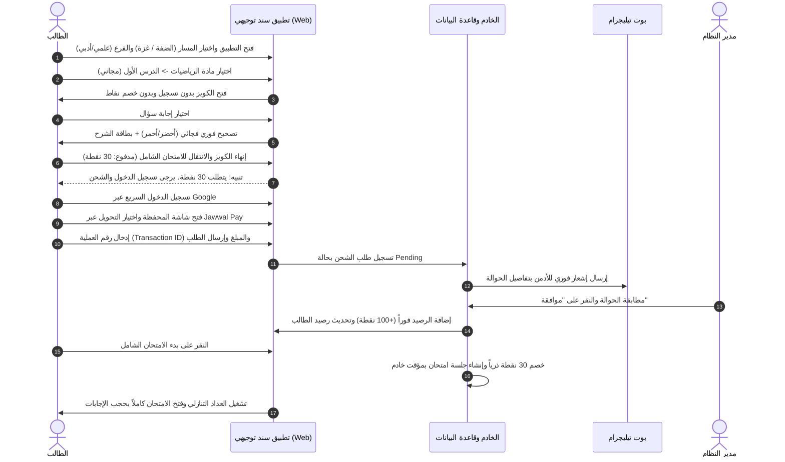
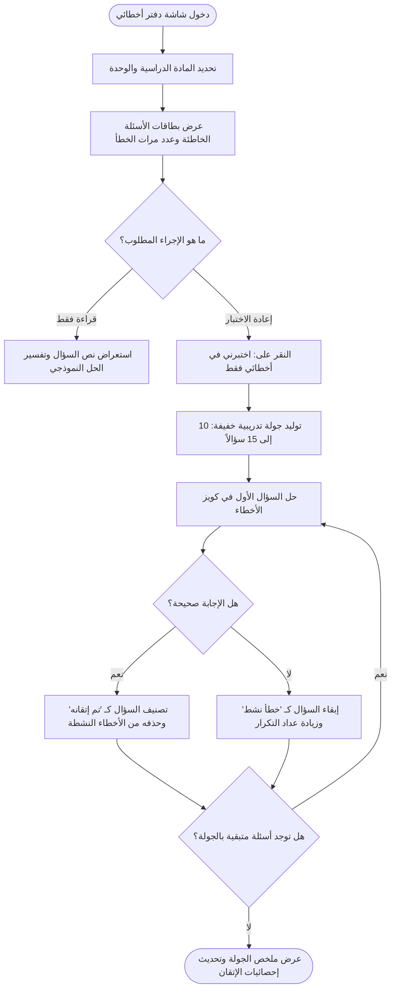
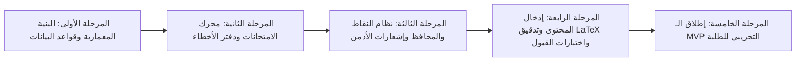

# Product Requirements Document (PRD) - Sanad Tawjihi ("سند توجيهي")

**Document Title:** وثيقة متطلبات المنتج لتطبيق ومنصة "سند توجيهي" التعليمية  
**Product Name:** سند توجيهي (Sanad Tawjihi)  
**Product Type:** تطبيق ويب متجاوب (Responsive Web Application / Mobile-First PWA Shell)  
**Stage:** النسخة الأولية التجريبية (MVP - Minimum Viable Product)  
**Target Market:** دولة فلسطين (طلبة الثانوية العامة - التوجيهي)  
**Document Owner:** Senior Product Manager & Business Analyst  
**Document Status:** Draft - Under Review (مسودة قيد المراجعة)  
**Last Updated:** أكتوبر 2026  

---

## 1. Product Overview

### 1.1 نبذة عن المنتج
**"سند توجيهي" (Sanad Tawjihi)** هو منصة وتطبيق ويب متجاوب عالي الأداء، موجه ومصمم خصيصاً لطلبة الثانوية العامة (**التوجيهي**) في فلسطين لكلا الفرعين (العلمي والأدبي). يقوم التطبيق على بنك أسئلة رقمي تفاعلي مبني بالكامل (100%) بنظام **الاختيار من متعدد (MCQ)**، متوافقاً تماماً مع المعايير الوزارية لمنهاج "الإنجاز" الفلسطيني ونماذج الامتحانات الرسمية.

يوفر التطبيق بيئة تعليمية ذكية قائمة على ثلاثة أركان رئيسية:
1. **التدريب المركز الفوري (Practice Mode):** كويزات لكل درس ووحدة مع تصحيح فجائي وشرح توضيحي فوري لكل خيار لترسيخ المعلومة لحظياً.
2. **محاكاة الامتحان الوزاري (Simulation Mode):** امتحانات وزارية وتجريبية شاملة محكومة بمؤقت زمني حقيقي من الخادم، وتنقل مرن وتسليم تلقائي مع مراجعة نموذجية بعد انتهاء الوقت.
3. **دفتر الأخطاء التفاعلي (Smart Mistakes Notebook):** أداة ذكية تلتقط كل سؤال أخطأ فيه الطالب تلقائياً، وتتيح له إعادة اختبار نفسه في أخطائه فقط ضمن جولات مركزة لتصفير نقاط الضعف حتى إتقانها.

يعتمد التطبيق في الـ MVP نموذج اقتصادي مرن مبني على **النقاط المدفوعة (Points Economy)**؛ حيث تُتاح الدروس الأولى من كل وحدة مجاناً كفترة تجربة، ويتم شحن الرصيد عبر المحافظ الإلكترونية المحلية الأكثر انتشاراً في فلسطين (**Jawwal Pay**، **PalPay**، وحسابات **بنك فلسطين / Reflect**) مع تأكيد وموافقة سريعة من لوحة تحكم الإدارة مدعومة بنظام إشعارات فوري.

---

## 2. Problem Statement

### 2.1 التحديات والمشكلات التي يحلها المنتج
1. **تشتت مصادر الدراسة والامتحانات الورقية:** يعاني طالب التوجيهي الفلسطيني من تراكم "الدوسيات" وأوراق الامتحانات السابقة غير المصححة نموذجياً، وصعوبة الوصول لحلول معللة وموثوقة لأسئلة "ضع دائرة".
2. **رهبة الوقت وضغط الامتحان الوزاري:** تفتقر بيئة الدراسة التقليدية لتدريب الطالب على إدارة الوقت تحت ضغط المؤقت الزمني، مما يسبب رسوباً أو ضياع علامات بسبب التوتر وسوء توزيع الدقائق.
3. **ضياع الأخطاء وتكرارها:** عندما يحل الطالب امتحاناً ورقياً ويخطئ، نادراً ما يدون خطأه أو يعود لحله مجدداً، مما يجعل نفس الخطأ يتكرر في الامتحان الوزاري الفعلي.
4. **عزلة وخصوصية الواقع الفلسطيني المقسم:** وجود فجوة حقيقية بين طلبة الضفة الغربية (الذين يتبعون المنهاج الكامل الاعتيادي) وطلبة قطاع غزة (الذين يتبعون رُزماً تعليمية ومحذوفات مقرة رسمياً نظراً للظروف الاستثنائية)، وغياب أي تطبيق يفرز المنهاجين بدقة في واجهة واحدة.
5. **عوائق الدفع الإلكتروني التقليدية:** بطاقات الائتمان العالمية (Visa / MasterCard) غير متوفرة لغالبية الطلبة وذويهم في فلسطين، مما يحرمهم من المنصات التعليمية غير الداعمة للمحافظ الرقمية المحلية كجوال باي وبال بي.

---

## 3. Product Goals

### 3.1 الأهداف الاستراتيجية والتجارية
* **G-001 (التمكين الأكاديمي):** رفع جاهزية طالب التوجيهي الفلسطيني لحصد معدلات مرتفعة في أسئلة الاختيار من متعدد عبر توفير 300 - 500 سؤال نموذجي مدقق في المرحلة الأولى.
* **G-002 (التعلم النشط من الخطأ):** تحويل الخطأ إلى فرصة تعلم دائمة عبر تقليص نسبة الأخطاء المكررة بنسبة 60% بفضل "دفتر الأخطاء الذكي".
* **G-003 (نموذج ربحي ميسر وعادل):** إثبات جدوى النموذج المالي القائم على النقاط منخفضة التكلفة، وتحقيق نسبة تحويل (Conversion Rate) لا تقل عن 15% من الطلاب المجانيين إلى المشتركين بالنقاط.
* **G-004 (سرعة وخفة التشغيل):** توفير تجربة تصفح فائقة الخفة والسرعة (< 300ms للتصحيح الفوري) تعمل بسلاسة على شبكات الهواتف المحمولة وتستهلك أدنى حد من حزم الإنترنت.

---

## 4. Non-Goals

### 4.1 ما هو خارج نطاق المشروع عمداً (Explicitly Excluded)
* **NG-001 (الأسئلة المقالية والإنشائية):** المنصة تركز بنسبة 100% على أسئلة الاختيار من متعدد (MCQ) فقط، ولا تشمل تصحيح الأسئلة الإنشائية أو الكتابية.
* **NG-002 (الفصول الافتراضية وشروحات الفيديو المباشرة):** لا يشمل التطبيق بثوثاً مباشرة، فيديوهات مسجلة، أو مكالمات فيديو بين المعلم والطالب.
* **NG-003 (الربط المباشر مع API البنوك):** لا توجد بوابات ربط بنكي لحظية آلية (Payment Gateway API) في الـ MVP؛ كافة عمليات التحقق من الدفع تتم يدوياً بواسطة الأدمن.
* **NG-004 (العمل أوفلاين بالكامل بدون إنترنت):** يتطلب التطبيق وجود اتصال بالإنترنت لبدء الاختبارات وخصم النقاط ومزامنة النتائج مع الخادم.
* **NG-005 (منصة المعلمين المتعددين - Multi-Vendor Marketplace):** لوحة تحكم الأدمن مركزية للمنصة فقط، وليست سوقاً مفتوحاً للمعلمين الخارجيين لبيع دوراتهم في هذه المرحلة.
* **NG-006 (تغطية كافة المواد):** يقتصر الـ MVP على 3 مواد أساسية فقط (الرياضيات، اللغة العربية، اللغة الإنجليزية). باقي المواد مؤجلة لمراحل لاحقة.

---

## 5. Target Users

1. **طلبة التوجيهي - الفرع العلمي:** يركزون على الرياضيات واللغة الإنجليزية، ويهتمون بدقة صياغة المسائل الرياضية وسرعة الحل.
2. **طلبة التوجيهي - الفرع الأدبي:** يركزون على اللغة العربية واللغة الإنجليزية وقواعدها، ويهتمون بحفظ وفهم شروحات القواعد والنصوص.
3. **طلبة التوجيهي في قطاع غزة:** يحتاجون للتدرب وفق الرزم التعليمية والمحذوفات المقرة رسمياً دون تشتيت بالمنهاج الكامل.
4. **أولياء أمور طلبة التوجيهي:** يمتلكون المحافظ الإلكترونية (Jawwal Pay / PalPay) لتمويل تدريب أبنائهم ومتابعة علاماتهم.
5. **مدير النظام ومدخل المحتوى (Admin / Teacher):** المسؤول عن إدخال وتدقيق الأسئلة والمعادلات الرياضية، ومراجعة وتأكيد طلبات شحن النقاط.

---

## 6. User Personas

### Persona 1: الطالب أحمد (توجيهي علمي - نابلس)
* **العمر:** 17 عاماً.
* **الجهاز:** هاتف ذكي أندرويد متوسط المواصفات.
* **الهدف:** التدرب على حل مسائل التفاضل والتكامل بسرعة لكسر خوفه من ضيق وقت امتحان الرياضيات الوزاري.
* **نقاط الألم:** بطء تحميل الصور ومشكلة تعتيم المعادلات في المجموعات الطلابية، وتكرار نفس الأخطاء الحسابية.
* **السلوك المالي:** يشحن رصيده بنفسه عبر محفظة Jawwal Pay بمبالغ صغيرة (10 - 25 شيكل).

### Persona 2: الطالبة سارة (توجيهي أدبي - غزة)
* **العمر:** 18 عاماً.
* **الجهاز:** هاتف ذكي مشترك مع العائلة مع اتصال إنترنت محدود.
* **الهدف:** حل أسئلة "ضع دائرة" لمادة اللغة العربية المتوافقة حصراً مع الرزم التعليمية المقرة لغزة لعام 2026.
* **نقاط الألم:** ضياع الوقت في أسئلة محذوفة، وبطء مواقع الويب الثقيلة.
* **السلوك المالي:** يمول والدها رصيدها عبر محفظة PalPay.

### Persona 3: الأستاذ كمال (معلم خبير ومدير النظام - Admin)
* **الدور:** منسق المحتوى ومسؤول العمليات المالية.
* **الهدف:** إدخال الأسئلة وتنسيق المعادلات الرياضية بـ LaTeX بسرعة، ومطابقة حوالات الطلاب وتفعيل النقاط لهم في أقل من 15 دقيقة دون الحاجة للجلوس طوال اليوم أمام الحاسوب.

---

## 7. User Needs

* **UN-001 (التغذية الراجعة الفورية):** معرفة سبب الخطأ لحظة وقوعه وتثبيت المعلومة الصحيحة بالشرح الوافي.
* **UN-002 (المحاكاة الوزارية الواقعية):** تجربة الامتحان تحت ضغط العداد التنازلي ونفس شروط وزارة التربية والتعليم.
* **UN-003 (المعالجة المخصصة للأخطاء):** أداة تجمع الأسئلة الخاطئة دون تكرار وتتيح إعادة حلها حتى تصبح متقنة.
* **UN-004 (طرق دفع محلية ميسرة):** إمكانية شحن الرصيد بمبالغ تبدأ من 10 شيكل عبر المحافظ الفلسطينية دون الحاجة لبطاقة بنكية دولية.
* **UN-005 (تجربة استخدام مخصصة للموبايل RTL):** واجهة عربية سريعة ومريحة لليد والعين على شاشات الهواتف.

---

## 8. User Stories

| المعرف (ID) | بصفتي (As a) | أريد أن (I want to) | حتى أتمكن من (So that) |
|---|---|---|---|
| **US-001** | طالب زائر (Guest) | تجربة أول درسين من كل وحدة مجاناً دون إنشاء حساب | الحكم على جودة الأسئلة والشروحات قبل الشحن. |
| **US-002** | طالب | اختيار مساري الإقليمي (الضفة الغربية أو قطاع غزة) فور دخولي | دراسة المنهاج أو الرزم المعتمدة لواقعي الجغرافي. |
| **US-003** | طالب مسجل | حل كويزات تدريبية مع تصحيح فوري وشرح توضيحي | تثبيت القواعد ومعرفة سبب الخطأ لحظياً. |
| **US-004** | طالب مسجل | خوض امتحان شامل ثابت وموقوت بمؤقت خادم حقيقي | معايشة بيئة وضغط الامتحان الوزاري الحقيقي دون غش. |
| **US-005** | طالب مسجل | مراجعة "دفتر أخطائي" وخوض كويز بجولات مريحة في الأسئلة الخاطئة | معالجة نقاط ضعفي وتصفير قائمة أخطائي. |
| **US-006** | طالب مسجل | استعراض نتائج ومحاولات امتحاناتي السابقة وشروحاتها مجاناً | الاستفادة الدائمة من الاختبارات التي سددت نقاطها سابقاً. |
| **US-007** | طالب مسجل | شحن محفظتي برقم حوالة جوال باي أو بال بي أو بنك فلسطين | فتح الامتحانات والكويزات المدفوعة ومتابعة تدريبي. |
| **US-008** | طالب مسجل | مشاركة بطاقة نتيجتي وعلامتي مباشرة عبر واتساب بنص منسق | مشاركة إنجازاتي مع عائلتي وزملائي وتحفيزهم. |
| **US-009** | مدير النظام (Admin) | لوحة تحكم لإدخال الأسئلة والمعادلات الرياضية بصيغة LaTeX | بناء وتحديث بنك الأسئلة بدقة أكاديمية عالية. |
| **US-010** | مدير النظام (Admin) | تلقي إشعار فوري عبر تيليجرام عند وصول طلب شحن نقاط ومطابقته بنقرة زر | اعتماد رصيد الطالب بسرعة خلال مهلة الـ 15 دقيقة. |

---

## 9. MVP Scope

### 9.1 داخل نطاق النسخة الأولى (In Scope)
* **المسارات الإقليمية:** مسار مستقل لمنهاج الضفة الغربية ومسار مستقل لرزم قطاع غزة مع زر تبديل علوي.
* **المحتوى الأكاديمي:** الفروع (العلمي والأدبي)، لـ 3 مواد: (الرياضيات، اللغة العربية، اللغة الإنجليزية).
* **نمط الأسئلة:** اختيار من متعدد (MCQ) بنسبة 100% مع 4 خيارات لكل سؤال.
* **محرك الاختبارات:**
  * كويزات تدريبية (Practice Mode) بتصحيح فوري وشرح الإجابة.
  * امتحانات وزارية وتجريبية شاملة محاكية (Mock Exam Mode) بمؤقت خادم حقيقي وتسليم تلقائي.
* **دفتر الأخطاء الذكي:** إضافة تلقائية، فلترة بالمادة والوحدة، وجولات تدريبية (10 - 15 سؤالاً) مع تصفير الخطأ عند الإتقان.
* **نظام النقاط المعتمد:**
  * أول درسين مجاناً (0 نقطة).
  * كويز الدرس = **10 نقاط**.
  * كويز الوحدة = **20 نقطة**.
  * الامتحان الشامل للمنهاج = **30 نقطة**.
* **بوابات الشحن اليدوية:** Jawwal Pay، PalPay، بنك فلسطين / Reflect (10 شيكل = 100 نقطة، 25 شيكل = 300 نقطة، 50 شيكل = 700 نقطة).
* **إشعارات الأدمن الفورية:** ربط طلبات الشحن ببوت تيليجرام فوري لتحقيق مهلة الـ 15 دقيقة.
* **المعادلات الرياضية:** دعم كامل لصيغة LaTeX / KaTeX للمسائل والتفاضل والتكامل والكسور.
* **واجهة الهاتف وتثبيت التطبيق:** تصميم عربي متجاوب (Mobile-First RTL) مع ملف Manifest لتثبيت PWA Standalone.

### 9.2 خارج نطاق النسخة الأولى (Out of Scope)
* العمل أوفلاين 100% بدون اتصال بالإنترنت.
* الأسئلة المقالية والتصحيح بالذكاء الاصطناعي.
* الربط الآلي عبر API مع البنوك والشركات المالية.
* المواد التخصصية الأخرى (الفيزياء، الكيمياء، التاريخ، التكنولوجيا...).
* توليد صور بطاقات النتائج عبر المتصفح (Canvas)؛ يُكتفى بمشاركة النصوص وروابط الويب.
* منصة متعددة المعلمين وحسابات البائعين.

---

## 10. Core Features

### Feature 1: محرك كويزات التدريب الفوري (Practice Quiz Engine)
* **Feature ID:** FEAT-001
* **Feature Name:** Practice Mode Quiz Engine
* **Purpose:** تمكين الطالب من التدرب الذاتي المركز على دروس ووحدات المنهاج مع التغذية الراجعة والشرح اللحظي.
* **User Story:** US-003
* **Functional Requirements:** FR-007, FR-008
* **Business Rules:** BR-001, BR-002, BR-003
* **Edge Cases:** انقطاع الإنترنت أثناء الحل، تغيير الخيار بعد النقر.
* **Error States:** فشل تحميل الأسئلة، عدم وجود اتصال عند طلب كويز جديد.
* **Acceptance Criteria:** AC-001
* **Priority:** Must Have

### Feature 2: محاكي الامتحانات الوزارية الشاملة (Mock Exam Simulator)
* **Feature ID:** FEAT-002
* **Feature Name:** Ministerially Timed Mock Exam Simulator
* **Purpose:** محاكاة ظروف الامتحان الوزاري الرسمي بضغط الوقت وضمان نزاهة التقييم ومنع الغش.
* **User Story:** US-004
* **Functional Requirements:** FR-009, FR-010, FR-011
* **Business Rules:** BR-003, BR-004, BR-005
* **Edge Cases:** إغلاق المتصفح أثناء الامتحان، انطفاء شحن الهاتف، نفاد الوقت بدون حل كافة الأسئلة.
* **Error States:** عدم كفاية رصيد النقاط، فقدان الاتصال أثناء التسليم النهائي.
* **Acceptance Criteria:** AC-002
* **Priority:** Must Have

### Feature 3: دفتر الأخطاء التفاعلي الذكي (Smart Mistakes Notebook)
* **Feature ID:** FEAT-003
* **Feature Name:** Smart Mistakes Notebook & Remedial Quizzes
* **Purpose:** رصد نقاط الضعف الأكاديمية تلقائياً وتمكين الطالب من إعادة حلها حتى إتقانها تماماً.
* **User Story:** US-005
* **Functional Requirements:** FR-012, FR-013, FR-014, FR-015
* **Business Rules:** BR-005, BR-006
* **Edge Cases:** تكرار الخطأ في نفس السؤال، تراكم عشرات الأخطاء، إعادة الخطأ في سؤال تم إتقانه سابقاً.
* **Error States:** لا توجد أخطاء مسجلة بالمادة المختارة.
* **Acceptance Criteria:** AC-003
* **Priority:** Must Have

### Feature 4: اقتصاد النقاط وشحن المحافظ الفلسطينية (Points Economy & Wallet)
* **Feature ID:** FEAT-004
* **Feature Name:** Points Economy & Manual Wallet Recharge
* **Purpose:** إتاحة نموذج ربحي مرن يتناسب مع قدرة الطالب الفلسطيني عبر محافظ Jawwal Pay و PalPay وبنك فلسطين.
* **User Story:** US-007
* **Functional Requirements:** FR-016, FR-017, FR-018, FR-019
* **Business Rules:** BR-007, BR-008, BR-009, BR-010
* **Edge Cases:** إدخال رقم حوالة خاطئ أو مكرر، رفض الأدمن للطلب، انقطاع الاتصال لحظة خصم النقاط.
* **Error States:** فشل التحقق من العملية، رصيد نقاط غير كافٍ لفتح الاختبار.
* **Acceptance Criteria:** AC-004
* **Priority:** Must Have

### Feature 5: لوحة تحكم الإدارة وإشعارات التيليجرام (Admin Portal & Alerts)
* **Feature ID:** FEAT-005
* **Feature Name:** Admin Management & Instant Telegram Notification
* **Purpose:** تمكين الإدارة من تغذية بنك الأسئلة بالمعادلات والشروحات، ومطابقة الحوالات خلال 15 دقيقة عبر إشعارات تيليجرام.
* **User Story:** US-009, US-010
* **Functional Requirements:** FR-020, FR-021, FR-022, FR-023
* **Business Rules:** BR-011, BR-012
* **Edge Cases:** إرسال صورة إيصال تالفة أو كبيرة الحجم، تعطل خدمة التيليجرام.
* **Error States:** خطأ في بناء كود LaTeX، فشل تسجيل العملية المالية.
* **Acceptance Criteria:** AC-005
* **Priority:** Must Have

### Feature 6: المسارات الإقليمية المنفصلة (Regional Curriculum Separation)
* **Feature ID:** FEAT-006
* **Feature Name:** West Bank vs. Gaza Regional Separation
* **Purpose:** الفصل الكامل والتام بين منهاج طلبة الضفة الغربية ورزم ومحذوفات طلبة قطاع غزة.
* **User Story:** US-002
* **Functional Requirements:** FR-005, FR-006
* **Business Rules:** BR-013
* **Edge Cases:** تبديل المسار في منتصف جلسة التصفح، وجود أسئلة مشتركة بين المنهاجين.
* **Error States:** عدم توفر أسئلة في مسار معين لوحدة دراسية محددة.
* **Acceptance Criteria:** AC-006
* **Priority:** Must Have

---

## 11. Functional Requirements

### 11.1 المصادقة وإدارة الحسابات (Authentication & User Profile)
* **FR-001 (وضع الزائر التجريبي):** يتيح النظام تصفح المنهاج وحل كويزات أول درسين من كل وحدة دون إلزام بإنشاء حساب، مع حفظ مؤقت للبيانات في `localStorage`.
* **FR-002 (التسجيل وتسجيل الدخول):** يوفر النظام تسجيلاً سريعاً بالبريد الإلكتروني وكلمة المرور، بالإضافة لتسجيل الدخول بنقرة واحدة عبر حساب Google (OAuth 2.0).
* **FR-003 (دمج بيانات الزائر الذكي):** عند إنشاء حساب جديد لأول مرة، يقوم النظام بترحيل سجل أخطاء ونتائج الزائر تلقائياً من `localStorage` إلى قاعدة البيانات السحابية. في حال تسجيل الدخول بحساب قائم، يُخيّر المستخدم بين الدمج أو الإبقاء على بيانات السحابة.
* **FR-004 (الملف الشخصي والمحفظة):** شاشة مخصصة تعرض اسم الطالب، فرعه الأكاديمي، مساره الإقليمي الحالي، رصيد النقاط، وسجل الحوالات وتفاصيل حالتها.

### 11.2 استعراض المنهاج والمسارات الإقليمية (Curriculum & Regions)
* **FR-005 (شاشة التخصيص الإقليمي):** شاشة ترحيبية إلزامية عند أول دخول للاختيار بين: [طلاب الضفة الغربية] أو [طلاب قطاع غزة]، مع زر تبديل دائم في الشريط العلوي للتطبيق.
* **FR-006 (فصل الهيكل التعليمي):** فصل تام في قواعد البيانات والواجهات لشجرة المنهاج؛ قسم الضفة يتبع المنهاج الكامل، وقسم غزة يتبع الرزم التعليمية والمحذوفات المعتمدة، مع ربط النقاط والمحفظة بنفس الحساب الموحد.

### 11.3 كويزات التدريب الفوري (Practice Mode)
* **FR-007 (حزمة بيانات التدريب السريعة):** إرسال الأسئلة والخيارات الأربعة وشروحات الإجابة مباشرة في حزمة البيانات الأولية للمتصفح لتحقيق استجابة فائقة (< 100ms) وتجاوز مشاكل بطء الاتصال.
* **FR-008 (التصحيح الفجائي والتعليل):** بمجرد نقر الطالب على أي خيار، يتلون الخيار فوراً (أخضر إذا كان صحيحاً، وأحمر إذا كان خاطئاً مع تلوين الخيار الصحيح بالأخضر)، وتنبثق بطاقة الشرح والتفسير فوراً أسفل السؤال مع إقفال خيارات السؤال.

### 11.4 محاكي الامتحانات الشاملة الوزارية (Timed Mock Exams)
* **FR-009 (نماذج الامتحانات الوزارية الثابتة):** تنظيم الامتحانات الشاملة كـ نماذج وزارية وتجريبية محددة وثابتة مسبقاً (مثل: امتحان وزاري 2025 - دورة أولى، امتحان تجريبي رقم 1) تحاكي الورقة الرسمية في توزيع الأسئلة والوزن الأكاديمي.
* **FR-010 (أمان الامتحان وحجب الإجابات):** حجب الخيارات الصحيحة والتفسيرات بالكامل من حزمة بيانات الامتحان المرسلة للمتصفح، وعدم إرسالها إلا بعد تسليم الامتحان وتقييمه على الخادم.
* **FR-011 (مؤقت الخادم الصارم - Wall-Clock Timer):** ربط وقت الامتحان بمؤقت خادم تنازلي صارم (`ends_at = started_at + duration`). إذا أغلق الطالب المتصفح أو انقطع شحن جهازه، يستمر الوقت بالتناقص لمنع استغلال التوقف للغش. عند انتهاء الوقت، يُقفل الامتحان تلقائياً ويُسلّم إجاباته مع احتساب الأسئلة المتروكة فارغة بدرجة صفر.
* **FR-012 (شبكة التنقل والتسليم):** إتاحة شبكة تنقل كاملة بين أرقام الأسئلة، مع إمكانية وضع علامة مراجعة (Flag for review)، وشاشة تأكيد قبل التسليم توضح الأسئلة المتبقية دون حل.

### 11.5 دفتر الأخطاء التفاعلي (Smart Mistakes Notebook)
* **FR-013 (الالتقاط التلقائي وعدم التكرار):** ترحيل أي سؤال يجيب عنه الطالب بشكل خاطئ تلقائياً إلى دفتر أخطائه. يُضبط السؤال بقيد فريد `(user_id, question_id)` بحيث لا يتكرر السؤال في القائمة مع زيادة عداد مرات الخطأ `error_count`.
* **FR-014 (فلترة الأخطاء):** إمكانية تصفح قائمة الأخطاء وتصفيتها حسب: المادة الدراسية، والوحدة الدراسية، والمسار الإقليمي.
* **FR-015 (كويز الجولات المريحة في الأخطاء):** زر "اختبرني في أخطائي فقط"، يولد كويزاً تدريبياً مركزاً مقسماً إلى جولات خفيفة (10 إلى 15 سؤالاً في الجولة الواحدة) لتفادي إحباط الطالب بالأخطاء المتراكمة.
* **FR-016 (تصفير وإتقان الأخطاء):** عند حل السؤال الخاطئ حلاً صحيحاً داخل كويز الأخطاء، يُصنف كـ "تم إتقانه" ويُزال فورياً من عداد الأخطاء النشطة. وفي حال أخطأ فيه مجدداً في أي امتحان شامل لاحق، يعود تلقائياً كـ "خطأ نشط".

### 11.6 نظام النقاط والمحافظ الإلكترونية (Points & Payments)
* **FR-017 (عرض رصيد المحفظة):** عرض دائم لرصيد النقاط أعلى شريط التطبيق، مع ظهور مؤشر القفل (Lock Icon) وتكلفة الدخول بالنقاط بجانب كل اختبار مدفوع.
* **FR-018 (نموذج إرسال الحوالة):** واجهة مخصصة تبرز أرقام حسابات المنصة المعتمدة (جوال باي، بال بي، بنك فلسطين/Reflect)، وتتضمن حقلاً لاختيار المحفظة، وحقلاً لإدخال رقم العملية (Transaction ID)، وحقلاً لمبلغ الشيكل، مع إمكانية إرفاق صورة إشعار الحوالة (اختياري، بحد أقصى 1MB).
* **FR-019 (منع تكرار العمليات):** فحص فريد مركب يمنع تكرار إرسال الحوالة عبر المفتاح: `(payment_method + transaction_id)`.
* **FR-020 (تتبع حالة الطلب):** تحديث حالة الطلب لحظياً (Pending قيد المراجعة -> Approved معتمد -> Rejected مرفوض مع بيان السبب وزر لإعادة الإرسال).

### 11.7 لوحة تحكم الإدارة (Admin Dashboard)
* **FR-021 (إدارة المنهاج وبنك الأسئلة):** إضافة وتعديل الفروع والمواد والوحدات والدروس، وتحديد مسار المحتوى (الضفة / غزة / كلاهما).
* **FR-022 (دعم المعادلات الرياضية LaTeX):** محرر أسئلة يدعم إدخال نصوص المعادلات والتفاضل والتكامل وصيغ الرياضيات عبر مكتبة **LaTeX / KaTeX** في نصوص الأسئلة والخيارات والتفسيرات، مع قصر رفع الصور على المخططات والأشكال الهندسية (< 500KB).
* **FR-023 (إشعارات تيليجرام الفورية للحوالات):** ربط عمليات تقديم الشحن بـ Webhook يرسل إشعاراً فورياً على مجموعة/بوت تيليجرام خاص بالأدمن يتضمن: اسم الطالب، المحفظة، المبلغ، رقم العملية، ورابط مباشر لاعتماد أو رفض الحوالة بنقرة واحدة لتحقيق مهلة الـ 15 دقيقة.
* **FR-024 (التحكم في تسعير ومجانية الدروس):** قدرة الأدمن على تعيين أي درس كـ (`is_free`)، وتعديل تكلفة النقاط للاختبارات ديناميكياً.

### 11.8 تجربة المستخدم والتثبيت (PWA & Social Share)
* **FR-025 (التثبيت المباشر PWA):** شريط سفلي وزر بالقائمة لتثبيت التطبيق على الهواتف بنمط ملء الشاشة المستقل (`display: standalone`) دون شريط المتصفح، مع التقاط حدث `beforeinstallprompt` على أندرويد وتلميح إضافة للشاشة الرئيسية لآيفون Safari.
* **FR-026 (مشاركة الإنجاز النصية):** زر مشاركة سريع يولد نصاً جذاباً ورابطاً للمنصة عبر Web Share API وواتساب (مثلاً: *"حققت 95% في امتحان اللغة الإنجليزية الوزاري على تطبيق سند توجيهي! تدرب معي الآن: [Link]"*) دون أخطاء توليد الصور.

---

## 12. Non-Functional Requirements

* **NFR-001 (الأداء وزمن الاستجابة):** زمن استجابة التصحيح الفوري في نمط التدريب لا يتجاوز 100 مللي ثانية. زمن تحميل صفحات التطبيق على شبكات 3G/4G لا يتجاوز ثانيتين.
* **NFR-002 (التصميم المتجاوب Mobile-First RTL):** واجهات مخصصة لشاشات الهواتف بجميع أحجامها، باتجاه كامل من اليمين لليسار (RTL)، مع خط عربي حديث عالي المقروءة ومسافات لمس (Touch Targets) مريحة للإبهام لا تقل عن 44×44 بكسل.
* **NFR-003 (أمان العمليات ونزاهة الدرجات):** تنفيذ جميع عمليات خصم النقاط واعتماد جلسات الاختبار والتقييم على الخادم (Server-Side Atomic Transactions) لمنع أي تلاعب في الرصيد أو الدرجات عبر المتصفح.
* **NFR-004 (الموثوقية وتوفير البيانات):** ضغط كافة الصور المرفوعة تلقائياً (WebP/JPEG)، واستخدام صيغة KaTeX المتجهية الخفيفة للمعادلات لتقليل استهلاك حزم الإنترنت إلى أدنى حد ممكن.
* **NFR-005 (جلسة الجهاز الفردية - Concurrency Control):** قصر استخدام الحساب على جلسة نشطة واحدة في نفس الوقت (Single Active Session)؛ عند تسجيل الدخول من جهاز جديد يتم إنهاء الجلسة القديمة لمنع تداول الحساب المدفوع بين عدة طلاب.
* **NFR-006 (التوافقية والمتصفحات):** توافق كامل مع متصفحات Chrome و Safari و Edge و Firefox على أحدث إصدارين لنظامي Android و iOS.

---

## 13. User Flows

### 13.1 تدفق الطالب: تجربة درس مجاني ثم الشحن وفتح امتحان شامل

### 13.2 تدفق مراجعة وتصفير دفتر الأخطاء

---

## 14. Pages / Screens

1. **شاشة التخصيص الإقليمي (Region Onboarding Screen):** اختيار المسار [طلاب الضفة الغربية] أو [طلاب قطاع غزة].
2. **الصفحة الرئيسية وفهرس المواد (Home & Curriculum Screen):** استعراض المواد الثلاث، أشرطة الإنجاز، الرصيد العلوي، وزر التبديل الإقليمي.
3. **صفحة الوحدات والدروس (Unit & Lessons Screen):** عرض قائمة الدروس مع شارات (مجاني / قفل بالنقاط) وزر بدء الامتحان الشامل.
4. **شاشة كويز التدريب الفوري (Practice Quiz Screen):** شاشة نظيفة خالية من المشتتات، عرض السؤال والخيارات مع التصحيح اللحظي وبطاقة الشرح.
5. **شاشة الامتحان الشامل المحاكي (Exam Simulation Screen):** شريط علوي بالمؤقت التنازلي الحقيقي، شبكة تنقل، زر مراجعة لاحقاً، وزر تسليم الامتحان.
6. **شاشة نتيجة ومراجعة الامتحان (Exam Result & Review Screen):** تفاصيل العلامة والنسبة المئوية، وزر مراجعة الحلول النموذجية، وزر مشاركة النتيجة عبر واتساب.
7. **شاشة دفتر الأخطاء الذكي (Mistakes Notebook Screen):** تصفية الأخطاء، عداد الأخطاء النشطة، وزر "اختبرني في أخطائي فقط (جولة من 10 أسئلة)".
8. **شاشة المحفظة وشحن النقاط (Wallet & Recharge Screen):** عرض رصيد النقاط، باقات الشحن بالشيكل، أرقام حسابات جوال باي وبال بي، ونموذج إدخال رقم العملية.
9. **لوحة تحكم الإدارة (Admin Dashboard):**
   * تبويب إدارة بنك الأسئلة والمنهاج ومعادلات LaTeX.
   * تبويب مراجعة طلبات الشحن والمطابقة مع أزرار الموافقة والرفض.

---

## 15. Roles & Permissions

| الوظيفة / الصلاحية | زائر تجريبي (Guest) | طالب مسجل (Student) | مدير النظام (Admin) |
|---|:---:|:---:|:---:|
| تصفح أسماء المواد والوحدات والدروس | متاح | متاح | متاح |
| التبديل بين مساري الضفة وغزة | متاح | متاح | متاح |
| حل كويزات أول درسين مجاناً (0 نقطة) | متاح (تخزين محلي) | متاح (تخزين سحابي) | متاح |
| حل كويزات الوحدات والامتحانات الشاملة | غير متاح (يتطلب تسجيل وشحن) | متاح (بخصم نقاط) | متاح للتجربة |
| حفظ وتصفح "دفتر الأخطاء" | محلي بالجهاز فقط | متاح ومزامن سحابياً | غير منطبق |
| تقديم طلب شحن رصيد بالمحافظ | غير متاح | متاح | غير منطبق |
| استعراض تاريخ الامتحانات وتفسيراتها مجاناً | غير متاح | متاح لمحاولاته السابقة | متاح لكافة الامتحانات |
| إضافة وتعديل المواد والأسئلة ومعادلات LaTeX | غير متاح | غير متاح | متاح بالكامل |
| تعديل مجانية وتكلفة النقاط للاختبارات | غير متاح | غير متاح | متاح بالكامل |
| اعتماد أو رفض طلبات شحن النقاط | غير متاح | غير متاح | متاح بالكامل |

---

## 16. Data Requirements

### 16.1 الكيانات الرئيسية وخصائصها (Entities & Attributes)
* **المستخدمون (Users):**
  * `id` (UUID), `email`, `full_name`, `avatar_url`, `stream` (scientific / literary), `region` (west_bank / gaza), `points_balance` (Integer >= 0), `created_at`.
* **المواد والوحدات والدروس (Curriculum Hierarchy):**
  * `subjects`: `id`, `name`, `stream`, `created_at`.
  * `units`: `id`, `subject_id`, `title`, `order_index`.
  * `lessons`: `id`, `unit_id`, `title`, `order_index`, `is_free` (Boolean, default: true for first 2 lessons), `target_region` (west_bank / gaza / all).
* **بنك الأسئلة (Questions):**
  * `id` (UUID), `lesson_id`, `exam_id` (Nullable), `question_text` (Supports LaTeX markdown), `image_url` (Nullable), `option_a`, `option_b`, `option_c`, `option_d`, `correct_option` (A/B/C/D), `explanation` (Supports LaTeX markdown), `target_region`.
* **نماذج الامتحانات الشاملة (Mock Exams):**
  * `id`, `subject_id`, `title` (e.g. امتحان وزاري 2025 - دورة أولى), `duration_minutes` (default: 60), `points_cost` (default: 30), `target_region`.
* **محاولات الامتحانات (Exam Attempts):**
  * `id`, `user_id`, `exam_id`, `started_at`, `ends_at` (Calculated on server), `submitted_at`, `score`, `total_questions`, `status` (in_progress / completed / expired), `answers_json`.
* **دفتر الأخطاء (Mistakes Notebook):**
  * `id`, `user_id`, `question_id`, `error_count` (Integer), `status` (active / mastered), `last_failed_at`, `mastered_at`.
  * *قيد فريد:* `UNIQUE(user_id, question_id)`.
* **طلبات شحن المحفظة (Wallet Transactions):**
  * `id`, `user_id`, `payment_method` (jawwal_pay / palpay / bop), `transaction_id`, `amount_ils`, `points_credited`, `receipt_image_url` (Nullable), `status` (pending / approved / rejected), `admin_note`, `created_at`, `reviewed_at`.
  * *قيد فريد مركب:* `UNIQUE(payment_method, transaction_id)`.

---

## 17. Integrations

1. **المصادقة (Google OAuth 2.0):** تسجيل دخول آمن وفوري للطلبة دون الحاجة لكتابة كلمات مرور معقدة.
2. **إشعارات التيليجرام (Telegram Bot Webhook):** ربط فوري لخادم التطبيق مع بوت تيليجرام خاص بالأدمن لإرسال تنبيهات لحظية بطلبات الشحن بروابط الموافقة.
3. **معالجة الصيغ الرياضية (KaTeX Engine):** مكتبة خفيفة وسريعة من طرف العميل لتصيير الرموز الرياضية والتفاضل والتكامل بدقة عالية.
4. **واجهة المشاركة السحابية (Web Share API & WhatsApp Deeplink):** مشاركة نصوص النتائج بروابط مباشرة دون معالجة رسومية.
5. **استضافة وتخزين الصور (Cloud Storage):** تخزين مضغوط ومؤمن لصور الرسوم الهندسية وإيصالات الحوالات مع تقييد الحجم.

---

## 18. Edge Cases

* **EC-001 (انقطاع الإنترنت أثناء تقديم الامتحان الشامل):** يستمر الطالب في حل الأسئلة المحملة محلياً في شاشته، مع ظهور شريط تحذيري؛ وعند النقر على "تسليم"، لا يُقفل الامتحان حتى يستعاد الاتصال لتوثيق التسليم بالسيرفر.
* **EC-002 (إغلاق المتصفح أو انطفاء بطارية الجوال أثناء الامتحان):** يستمر مؤقت السيرفر بالتناقص الفعلي. إذا عاد الطالب قبل انتهاء المدة يكمل ما تبقى من دقائق حقيقية، وإذا عاد بعدها يجد الامتحان مسلماً تلقائياً بنتيجته النهائية لمنع الغش.
* **EC-003 (انقطاع الاتصال لحظة خصم النقاط):** تتم عملية خصم النقاط كعملية ذرية (Atomic Transaction) مرتبطة بإنشاء معرف الجلسة. إذا فشل تحميل الأسئلة يُمنح الطالب نافذة سماح مدتها 10 دقائق لاستئناف الجلسة دون أي خصم إضافي.
* **EC-004 (تكرار الخطأ في كويز الأخطاء):** إذا حل الطالب سؤالاً خاطئاً داخل كويز الأخطاء مجدداً، يظل في حالة "خطأ نشط" مع زيادة عداد التكرار `error_count` دون إنشاء سجل مكرر في الجدول.
* **EC-005 (محاولة تسجيل الدخول من جهازين في نفس اللحظة):** يتم إبطال رمز الجلسة (JWT Token) للجهاز القديم فور تسجيل الدخول من جهاز جديد مع تنبيه المستخدم.
* **EC-006 (تبديل المسار الإقليمي):** عند تبديل الطالب من مسار الضفة إلى مسار غزة، يبقى رصيده المالي كما هو، ويتم تحديث شجرة المنهاج والامتحانات بما يوافق المسار المختار فوراً.

---

## 19. Error States

* **ERR-001 (رصيد نقاط غير كافٍ):** نافذة منبثقة واضحة: *"رصيدك الحالي (X نقطة) لا يكفي لفتح هذا الاختبار (يتطلب Y نقطة)"* مع زر توجيه مباشر لشاشة الشحن.
* **ERR-002 (رقم حوالة مكرر):** تنبيه مباشر: *"رقم العملية هذا تم إرساله مسبقاً، يرجى التحقق من كشف الحساب أو التواصل مع الدعم"*.
* **ERR-003 (طلب شحن مرفوض):** بطاقة تنبيه في المحفظة تبين سبب الرفض المدون من الأدمن: *"تم رفض الطلب: رقم الحوالة غير مطابق في كشف جوال باي"* مع زر لتصحيح البيانات وإعادة الإرسال.
* **ERR-004 (فشل الاتصال بالخادم):** شريط أحمر لطيف أعلى الشاشة: *"تعذر الاتصال بالخادم، جارٍ إعادة المحاولة تلقائياً..."*.
* **ERR-005 (رفع ملف صورة غير صالح):** تنبيه فوري بالواجهة: *"الملف المرفق غير مدعوم أو حجمه يتجاوز 1 ميجابايت، يرجى إرفاق صورة عادية"*.

---

## 20. Security & Privacy Requirements

* **SEC-001 (منع تعديل النقاط من الواجهة):** رصيد النقاط محمي بالكامل ويخضع للتحقق على الخادم (Server-Side Validation) عبر إجراءات مخزنة ومعاملات قاعدة بيانات ذرية.
* **SEC-002 (حماية محتوى الامتحانات ومنع فحص الكود):** حجب إجابات الامتحانات الشاملة من المتصفح لمنع معرفتها عبر الـ Console أو Network Tab في أدوات المطور.
* **SEC-003 (حماية البيانات والخصوصية):** تشفير كلمات المرور باستخدام خوارزميات التجزئة الحديثة (Bcrypt / Argon2)، واستخدام رموز وصول آمنة عبر بروتوكول HTTPS الصارم.
* **SEC-004 (حماية بيانات الحوالات):** عدم إظهار أرقام الحوالات أو أسماء المحولين لأي مستخدم آخر، وتقتصر رؤيتها على الطالب صاحب الحوالة ومدير النظام فقط.

---

## 21. Analytics & Tracking

* **AN-001 (تتبع مسار التحويل - Funnel):** تتبع نسبة الانتقال من تجربة الدروس المجانية -> التسجيل -> تقديم طلب شحن النقاط -> فتح أول امتحان مدفوع.
* **AN-002 (معدل إكمال الاختبارات):** قياس نسبة الطلاب الذين يكملون الامتحانات الشاملة حتى النهاية مقابل من ينسحبون في المنتصف.
* **AN-003 (مؤشرات سرعة موافقة الأدمن):** حساب الوقت الزمني الفاصل بين تقديم طلب الشحن وموافقة الأدمن لقياس مدى الالتزام بـ SLA الـ 15 دقيقة.
* **AN-004 (معدل إتقان الأخطاء):** تتبع نسبة الأسئلة التي تتحول من "خطأ نشط" إلى "تم إتقانه" في دفتر الأخطاء.

---

## 22. Success Metrics / KPIs

| مؤشر الأداء (KPI) | الوصف والمعيار المستهدف | دورية القياس |
|---|---|---|
| **معدل إكمال الامتحانات (Quiz Completion Rate)** | وصول نسبة إكمال الاختبارات التي يبدأها الطلبة إلى أكثر من **85%**. | أسبوعي |
| **معدل معالجة الأخطاء (Mistake Resolution Rate)** | تحويل أكثر من **60%** من أسئلة دفتر الأخطاء إلى حالة "تم الإتقان". | شهري |
| **معدل التحويل للدفع (Conversion Rate)** | تحويل **15% - 20%** من زوار الدروس المجانية إلى شراء باقات النقاط. | شهري |
| **زمن اعتماد الحوالات (Payment SLA)** | تحقيق متوسط موافقة للأدمن في أقل من **15 دقيقة** عبر إشعارات التيليجرام. | يومي |
| **سرعة وأداء النظام (Performance & Speed)** | استجابة التصحيح في أقل من **100ms**، وتحميل أولي أقل من **ثانيتين** على 4G. | مستمر |

---

## 23. Acceptance Criteria

### AC-001: كويز التدريب بتصحيح وشرح فوري (Practice Mode)
* **Given:** الطالب فتح كويز الدرس الأول في مادة اللغة العربية (سواء كان مسجلاً أو زائراً).
* **When:** ينقر الطالب على أحد الخيارات الأربعة للسؤال الأول.
* **Then:**
  1. يُقفل السؤال لمنع التلاعب وتتغير ألوان الخيارات فوراً (أخضر للصحيح، وأحمر للخاطئ مع إبراز الصحيح بالأخضر).
  2. تنبثق بطاقة الشرح والتفسير التوضيحية أسفل الخيارات فوراً دون تأخير (< 100ms).
  3. إذا كانت الإجابة خاطئة، يُدرج السؤال فوراً وبشكل تلقائي في "دفتر أخطاء" الطالب دون تكراره.

### AC-002: إنهاء وتسليم امتحان شامل موقوت (Timed Mock Exam)
* **Given:** الطالب يمتلك 30 نقطة في محفظته وبدأ الامتحان الشامل الوزاري لمادة الرياضيات (المؤقت الحقيقي: 60 دقيقة).
* **When:** يجيب عن الأسئلة وينقر على "تسليم الامتحان" مع تأكيد نافذة التنبيه، أو يصل مؤقت السيرفر الحقيقي إلى 00:00.
* **Then:**
  1. يُقفل الامتحان نهائياً وتُحتسب كافة الأسئلة المتروكة فارغة بدرجة صفر.
  2. تُعرض صفحة النتيجة متضمنة العلامة المئوية، عدد الإجابات الصحيحة والخاطئة والمتروكة، مع زر مراجعة التفسيرات لجميع الأسئلة.
  3. تتحدث إحصائيات لوحة التقدم وسجل الاختبارات ودفتر الأخطاء سحابياً فوراً.

### AC-003: كويز معالجة الأخطاء بالجولات المريحة
* **Given:** لدى الطالب 12 سؤالاً مسجلة في "دفتر أخطائي" لمادة اللغة الإنجليزية.
* **When:** ينقر الطالب على زر "اختبرني في أخطائي فقط".
* **Then:**
  1. يولد النظام جولة تدريبية تتضمن أسئلته الخاطئة فقط.
  2. عند إجابة أي سؤال بشكل صحيح، يتحول السؤال فوراً إلى "تم إتقانه" ويُخصم من عداد الأخطاء النشطة.
  3. عند إجابة أي سؤال بشكل خاطئ، يظل ضمن الأخطاء النشطة مع زيادة عداد تكرار الخطأ.

### AC-004: شحن المحفظة وموافقة الأدمن عبر إشعار التيليجرام
* **Given:** الطالب أرسل 10 شيكل عبر محفظة Jawwal Pay وأدخل رقم العملية في تطبيق سند توجيهي.
* **When:** يستلم الأدمن الإشعار الفوري على تيليجرام ويضغط على رابط الموافقة على الحوالة في لوحة التحكم.
* **Then:**
  1. تتحول حالة المعاملة فوراً إلى "معتمد" (Approved).
  2. يزداد رصيد الطالب بمقدار 100 نقطة بشكل فوري وموثق في سجل العمليات.
  3. يستطيع الطالب البدء فوراً في فتح أي امتحان مدفوع.

### AC-005: فصل مساري الضفة وغزة
* **Given:** الطالب في واجهة اختيار المسار واختار "طلاب قطاع غزة".
* **When:** يتصفح الطالب وحدات مادة الرياضيات.
* **Then:**
  1. تظهر أمامه فقط الوحدات والدروس المعتمدة وفق الرزم التعليمية والمحذوفات المقرة رسمياً لغزة لعام 2026.
  2. تظل تكلفة النقاط وأسعار الباقات موحدة ومتطابقة مع مسار الضفة.

---

## 24. Future Features (Phase 2 & Roadmap)

* **المرحلة 2.1 (Offline-First Sync):** دعم حل حزم الكويزات بدون إنترنت عبر Service Workers و IndexedDB مع المزامنة اللاحقة عند عودة الشبكة.
* **المرحلة 2.2 (التوسع في المنهاج والفروع):** إضافة مواد الفيزياء، الكيمياء، الأحياء، التاريخ، والتكنولوجيا، وتغطية الفروع التجارية والصناعية.
* **المرحلة 2.3 (الربط الآلي لبوابات الدفع API):** الربط المباشر مع PalPay و Jawwal Pay لشحن النقاط آلياً دون الحاجة لموافقة يدوية من الأدمن.
* **المرحلة 2.4 (نظام التحديات ولوحة المتصدرين):** بطولات أسبوعية تنافسية بين طلاب التوجيهي وجوائز نقاط للمتصدرين.
* **المرحلة 2.5 (تطبيق الهاتف المجمع Native iOS & Android):** رفع التطبيق على متجري Google Play و Apple App Store مع إشعارات Push دورية للتشجيع على الدراسة.

---

## 25. Risks & Dependencies

### 25.1 المخاطر واستراتيجيات المعالجة (Risks & Mitigations)
* **خطر تأخر مراجعة الأدمن للحوالات (SLA Breach):**
  * *الأثر:* استياء الطلاب وتراجع الشحن.
  * *المعالجة:* ربط الإشعارات ببوت تيليجرام يدعم النقر المباشر على زر "موافقة" دون الحاجة لفتح حاسوب، مع إشعار تذكيري إذا مر 10 دقائق على الطلب.
* **خطر تلاعب الطلاب برقم العملية:**
  * *الأثر:* شحن رصيد وهمي دون دفع حقيقي.
  * *المعالجة:* فرض شرط عدم تكرار المفتاح المركب `(المحفظة + رقم العملية)`، مع عدم إضافة أي نقطة إلا بعد تحقق بشري ومطابقة مع كشف حساب المحفظة.
* **خطر بطء إدخال المحتوى وبنك الأسئلة:**
  * *الأثر:* تأخر إطلاق التطبيق.
  * *المعالجة:* حصر الـ MVP بـ 3 مواد فقط ونماذج وزارية محددة ومعتمدة مسبقاً، وتجهيز قوالب إدخال مرنة تدعم LaTeX.

### 25.2 الاعتماديات الخارجية (Dependencies)
* استقرار شبكات الاتصالات المحمولة (جوال وأوريدو) في الضفة وغزة.
* استقرار منصات المحافظ الرقمية المحلية (Jawwal Pay / PalPay) لضمان توفر كشوف الحسابات.
* اعتمادية خدمة تيليجرام لإرسال تنبيهات الخادم للأدمن.

---

## 26. Open Questions

1. **أرقام الحسابات المالية الرسمية:** تحديد أرقام الهواتف والحسابات البنكية الرسمية للمنصة التي ستظهر للطلبة في شاشة الشحن قبل الإطلاق الميداني.
2. **سياسة الاسترداد وإلغاء الطلب:** هل يُسمح للطالب بإلغاء طلب الشحن يدوياً في حال اكتشف أنه أخطأ برقم العملية قبل أن يقوم الأدمن بمراجعته؟
3. **تطبيق كود الخصم (Promo Codes):** هل هناك حاجة لإضافة ميزة كوبونات الخصم للمدارس والمراكز التعليمية في الـ MVP أم ترحيلها للمرحلة الثانية؟
4. **ماذا يحدث إذا لم يراجع الأدمن طلب الشحن خلال 15 دقيقة؟**
   * _الافتراض المقترح (Assumption - pending confirmation):_ يظل الطلب في حالة Pending، ويرى الطالب رسالة "طلبك قيد المراجعة"، ويتلقى الأدمن تذكيراً تلقائياً عبر تيليجرام إذا مضت 10 دقائق دون مراجعة. هذا السلوك لم يُقرَّر رسمياً بعد ويحتاج لتأكيد.
5. **أخطاء الزائر محفوظة في localStorage وقد تضيع عند مسح بيانات المتصفح.**
   * _الافتراض المقترح (Assumption - pending confirmation):_ يظهر للزائر تنبيه واضح يقترح عليه تسجيل الدخول أو إنشاء حساب للاحتفاظ بأخطائه سحابياً. هذا القرار لم يُقرَّر رسمياً بعد ويحتاج لتأكيد.
6. **في نمط التدريب (Practice Mode)، ترسل الإجابات والشروحات للمتصفح لتحقيق السرعة، مما يعني أن مستخدماً تقنياً قد يقرأها قبل دفع النقاط.**
   * _الافتراض المقترح (Assumption - pending confirmation):_ القبول بهذا الأمر في الـ MVP لأن نمط التدريب غرضه تعليمي ولا شهادة فيه، في حين يظل الامتحان الشامل (Mock Exam) محمياً بالكامل عبر حجب الإجابات حتى لحظة التسليم. هذا القبول لم يُقرَّر رسمياً بعد ويحتاج لتأكيد.
7. **طلاب غزة الذين لديهم اتصال إنترنت ضعيف أثناء الامتحان الموقوت، مع العلم أن المؤقت يعمل على الخادم.**
   * _الافتراض المقترح (Assumption - pending confirmation):_ لا يُمنح وقت إضافي في الـ MVP بسبب ضعف الشبكة، ويُعاد النظر في هذه المسألة في المرحلة الثانية عند توفر Service Workers. هذا القرار لم يُقرَّر رسمياً بعد ويحتاج لتأكيد.

---

## 27. Recommended Development Phases

* **المرحلة 1 (الأسبوع 1):** إعداد المشروع — *(Tech Stack: Proposed, not decided — يُقترح Next.js / Vite + Supabase، غير محسوم بعد ويحتاج لقرار من صاحب المنتج)*، تصميم هيكل قاعدة البيانات، وإعداد نظام المصادقة ووضع الزائر.
* **المرحلة 2 (الأسبوع 2):** بناء محرك كويزات التدريب الفوري، ومحاكي الامتحانات الشاملة بالمؤقت الصارم، وتطبيق خوارزمية دفتر الأخطاء الذكي.
* **المرحلة 3 (الأسبوع 3):** بناء نظام محفظة النقاط وشاشات الحوالات، ولوحة تحكم الأدمن، وربط بوت إشعارات التيليجرام التلقائي.
* **المرحلة 4 (الأسبوع 4):** دعم صيغ معادلات KaTeX، إدخال بنك الأسئلة الأولي لـ 3 مواد، واختبار كافة معايير القبول (Acceptance Criteria) والتأكد من توافق الـ PWA.
* **المرحلة 5 (الإطلاق):** إطلاق النسخة التجريبية الأولى (MVP) لطلاب التوجيهي في فلسطين وبدء استقبال ردود الفعل والتقييمات.
