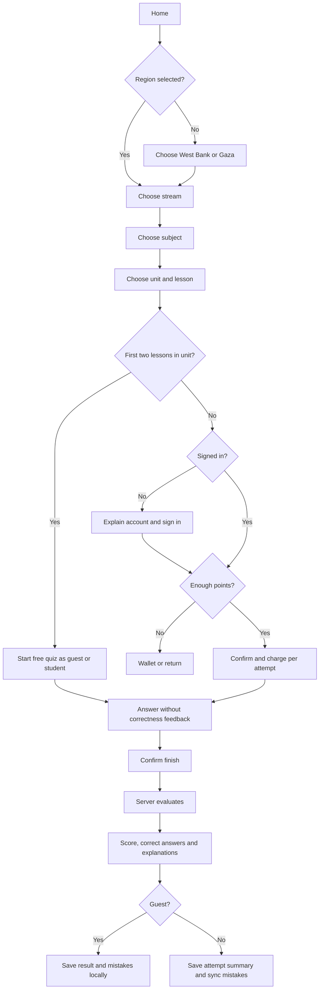
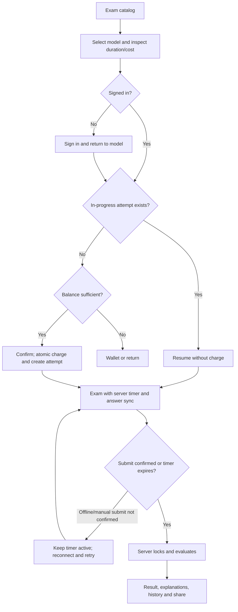
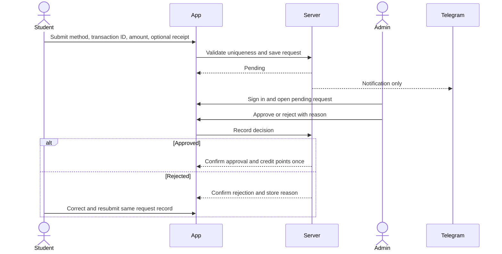
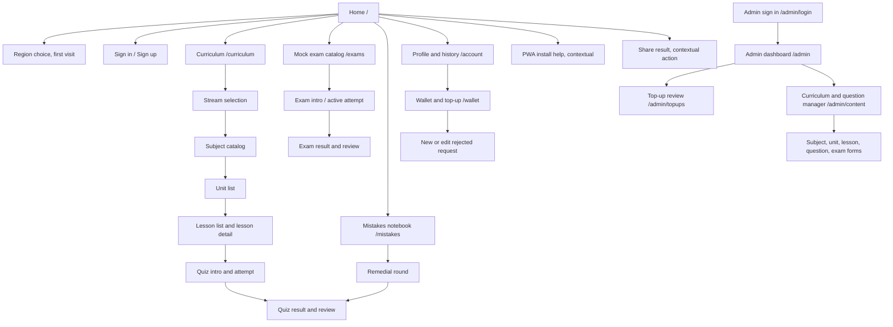

# UX Blueprint — Sanad Tawjihi

**Status:** MVP journey and information architecture blueprint  
**Inputs:** `docs/PRD.md` (draft under review) and `docs/UI_UX_REQUIREMENTS.md`  
**Audience:** Product, UX, content, and engineering teams  
**Scope:** Define journeys, flow logic, sitemap, and screen-level requirements. This is not a visual design specification.

## 1. Scope and priority

### Core MVP

- Guest exploration and free practice quizzes; student registration/sign-in with email/password or Google; branch and regional-path selection.
- Separate scientific and literary catalogs, each containing independent Mathematics, English, and Arabic subject records; West Bank and Gaza curriculum separation.
- Lesson and unit quizzes, attempt/result history, wallet points, manually reviewed top-ups, timed mock exams, and the mistakes notebook.
- Admin sign-in, content/question management, pricing/order controls, and top-up review. Telegram sends notifications only.
- Arabic RTL, mobile-first responsive behavior, PWA install prompt, and text result sharing.

### Supporting MVP

- Guest-to-account history/mistake migration and returning-user choice to merge guest data or retain cloud data.
- Profile, previous attempts and explanations, empty/loading/error states, keyboard and screen-reader support, and server-confirmed recovery states.
- PWA installation guidance and result sharing are supporting acquisition/retention actions; they do not alter the core study flow.

### Future (exclude from MVP journeys/screens)

- Fully offline quiz solving and later synchronization; additional subjects/academic streams; direct wallet payment APIs; competitions/leaderboards; native iOS/Android apps and push notifications.
- Do not add video/live lessons, essay questions, teacher marketplace, or any other feature excluded by the PRD.

## 2. Roles and access

| Role | Access and constraints |
|---|---|
| Guest | Browse regional curriculum; complete free first/second lesson quizzes; locally retain free attempts/results/mistakes; sign up or sign in for account features. No paid quizzes, mock exams, wallet requests, or synced history. |
| Student | All guest study journeys plus paid lesson/unit quizzes, mock exams, cloud history/mistakes, wallet requests, profile. Regional path can be changed; wallet balance is account-wide and unchanged. One active account session. |
| Admin | Separate protected admin experience; manage curriculum/questions/prices/order and approve/reject top-ups. Decisions happen only in authenticated dashboard, never Telegram. |

## 3. Product-wide experience rules

- Arabic is the MVP language and RTL is the default. Isolate numbers, transaction identifiers, and mathematical expressions with appropriate LTR/bidirectional handling.
- First visit starts on the home page; the visitor selects West Bank or Gaza before curriculum browsing. Persist the choice and keep a path switcher available.
- Student chooses academic stream, then subject, unit, and lesson. Never auto-recommend a lesson. Each stream has its own three subject records and content tree.
- First two lessons by `order_index` in every unit are free. Other lesson attempts default to 10 points; unit quiz attempts default to 20 points. Current configured price is authoritative and charged per attempt start. Clearly disclose cost and balance before starting.
- Mock exam start costs the template's current `points_cost` (default 30). Resume an existing in-progress attempt for the same user/template without another charge. Answers are stored as the server receives them; the server timer continues if the browser closes. Only answers received before `ends_at` count. Correct answers/explanations are withheld until server evaluation.
- Practice quiz answer selections remain provisional; correctness and explanation appear only after completed server evaluation. A registered user's attempt summary and mistakes sync to server; a guest's free attempt data is local.
- Do not report an action as successful before server confirmation. Preserve entered form values and selected answers on recoverable errors. Prevent duplicate submit while processing.
- Top-up starts pending; no points until an authenticated admin approves. Duplicate `(payment_method, transaction_id)` is rejected. Rejected request is corrected/resubmitted in the same record and retains its ID.
- Unknown official account numbers, refund/cancellation rules, and visual identity are not to be invented. Expose final top-up transfer instructions only after product supplies verified values.

## 4. MVP user journeys

### J1. First visit to free practice (guest)

1. Open Home; understand MCQ practice and choose West Bank or Gaza.
2. Choose scientific or literary stream, then one of its three subjects.
3. Browse unit and lesson list; identify first two lessons in each unit as free and choose a lesson.
4. Review quiz scope; start without account or charge.
5. Select/change answers, navigate questions, and finish with an unanswered-count confirmation.
6. Server evaluates; show score, correct answer and explanation per question. Save guest result/mistakes locally.
7. Offer a clear next step to curriculum, exam catalog, or sign-up for synced records/paid features. Do not block free practice with registration.

### J2. Student account creation/sign-in and guest data

1. From a paid action or account destination, explain why account is needed; choose email/password or Google.
2. Validate inline; preserve non-sensitive values when there is an error.
3. New account: migrate guest results/mistakes to cloud as required by PRD. Existing account: offer merge guest data or keep cloud data.
4. Land on the originally requested destination when possible; preserve stream/path and selected context.
5. If a new device signs in, end the previous active session and explain the session change.

### J3. Start a paid lesson or unit quiz

1. From curriculum, select a non-free lesson or unit quiz; show current cost and balance.
2. If signed out, explain sign-in requirement then return to this selection after auth.
3. If balance is insufficient, show current balance and required amount with routes to Wallet or back; do not start or charge.
4. Confirm start; server atomically charges current price and creates/stores the attempt. If start/content loading fails after charge, cancel attempt and refund as specified.
5. Complete the quiz like a free practice quiz. No correctness feedback until finish and evaluation.
6. Show result and explanations; store registered attempt summary and update active mistakes. Prior attempt results/explanations are available without charge.

### J4. Start, resume, and complete a timed mock exam

1. Open mock exam catalog; filter/content is scoped to selected stream and region. Each model shows title, duration, and price.
2. Before start, explain point deduction and strict server wall-clock timer. Require sign-in.
3. If an in-progress attempt exists for that template, offer Resume. Otherwise confirm start; server checks balance, deducts atomically, and creates one attempt.
4. Answer and navigate using question grid; flag for review. Show numeric countdown and per-answer saved/pending/error status. Do not expose correctness.
5. Manual submit prompts for confirmation and unanswered count. Submit only becomes complete when server confirms. If offline, explain timer continues and submission is not confirmed.
6. At `ends_at`, server closes and evaluates; unanswered/unreceived answers score zero. On return after expiry, show completed result. On reconnect before expiry, resume remaining real time and server-received answers.
7. Show score and explanations only after server evaluation; provide history and text share action.

### J5. Review and master mistakes

1. Signed-in student opens Mistakes; guest may view locally stored mistakes where supported, with a local-device persistence note.
2. Filter by subject, unit, and region; see active/mastered state and repeat count without duplicate question rows.
3. Start “quiz only my mistakes”; create a light 10–15 question round (or remaining smaller set).
4. Answer and submit; reveal evaluation after completion. Correct answers become mastered; incorrect answers remain active and increment count.
5. A later completed attempt answered incorrectly reactivates a mastered item. Empty state routes to curriculum or available quizzes.

### J6. Submit wallet top-up and track review

1. Signed-in student opens Wallet; sees balance, approved packages/rates when configured, methods, transfer instructions, and transaction history.
2. Choose method (Jawwal Pay, PalPay, Bank of Palestine/Reflect); enter transaction ID and amount in ILS; optionally attach supported image up to 1 MB.
3. Validate required fields, receipt type/size, and duplicate method/transaction pair inline. Preserve entered fields on errors.
4. Submit once; show Pending only after server confirms. Telegram notification informs admin only.
5. Track pending/approved/rejected status. Approval updates balance only when confirmed. Rejection displays admin reason and allows correction/resubmission of same record and ID.

### J7. Admin reviews a top-up

1. Admin signs in through separate protected route.
2. Dashboard shows pending requests and content-management entry points. Telegram alert links the admin to dashboard; it cannot perform decisions.
3. Open a request and review student, method, transaction ID, amount, and optional receipt.
4. Approve or reject; rejection requires reason. Confirm action with appropriate consequence.
5. Server confirms decision; approval credits points once, rejection records reason for student. Failure leaves request unchanged and offers retry.

### J8. Admin manages curriculum and questions

1. Admin opens content manager; select region targeting, stream-specific subject record, unit, and lesson.
2. Create/edit curriculum structure and lesson order; enforce unique order within unit. First two lessons derive free status; never manually mark free.
3. Create/edit MCQ with exactly four options, correct option and explanation; support LaTeX/KaTeX and optional diagram/image under 500 KB.
4. Set quiz/mock prices and exam template details as authorized. Review/save; show validation and server confirmation.

## 5. Mermaid journeys

### Guest free practice and account conversion

### Timed mock exam

### Wallet top-up review

## 6. Sitemap

### Navigation model

- Student/guest: Home, Curriculum, Exams, Mistakes (local guest data or signed-in), Account; Wallet available to signed-in users. On narrow screens use compact bottom navigation for highest-frequency destinations and place secondary destinations in a labeled menu.
- Admin: Dashboard, Top-up requests, Content/questions, account/sign-out. Keep admin navigation and visual shell distinct from student navigation.
- Breadcrumbs: region → stream → subject → unit → lesson. Keep a clear route back to parent listing.
- Preserve selected destination/context through sign-in and wallet detours when server state permits.

## 7. Cross-screen validation and states

- Every data view: loading, success, empty, recoverable error, server unavailable; announce meaningful status changes accessibly.
- Form fields have persistent labels, nearby validation, preserved values, submission-in-progress lock, success and retryable failure states.
- Quiz: unanswered count, submit confirmation, evaluation pending/failure with saved local answers and retry; no false result.
- Exam: server timer, answer saving/saved/error, reconnect, unconfirmed submit, expired, evaluated. An answer is accepted only if server receives it before deadline.
- Wallet: duplicate transaction, invalid/oversize optional receipt, pending, approved, rejected with reason and same-record resubmission.
- Curriculum: no published units/questions state; no inferred content availability.

## 8. Accessibility and responsive baseline

- RTL reading and focus order; full keyboard operation and visible focus. Accessible names for icon-only controls.
- Do not use color alone for free status, selected/unanswered/flagged answers, validation, or result. Pair status with text/icon and accessible label.
- High contrast, scalable text, no clipping/overlap, 44×44 px minimum touch targets, descriptive field labels/help/error relationships.
- Announce answer save, evaluation, and timer expiry to assistive technology. Timer is numeric; approaching/expired alert is not color-only.
- Mobile-first and natural scrolling; avoid wide curriculum/payment tables on phones. Keep essential actions visible without large fixed overlays obscuring questions/options. Expand to tablet/desktop without hiding core actions.
- Do not promise full offline operation. PWA support is installability only within MVP.

## 9. Decisions and dependencies to resolve before release

- PRD approval; verified payment account details and package conversion; cancellation/refund policy; behavior after the 15-minute review target; guest-local-data loss notice; detailed network-loss interaction during exams; approved visual identity assets.
- This blueprint specifies journey behavior where known and leaves these policy/content values unfilled. In particular, no financial destination or refund promise should be fabricated.
