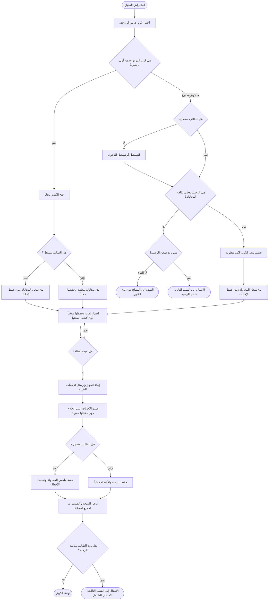
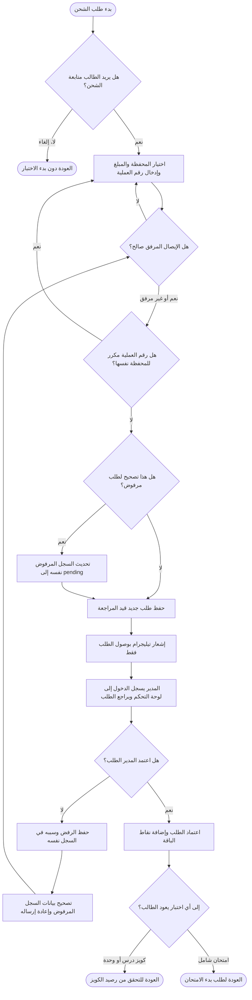
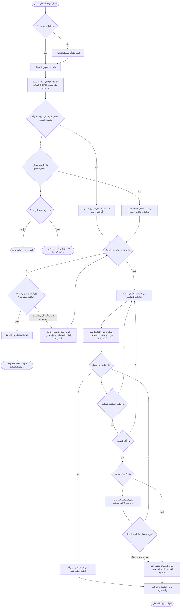

# مخطط النشاط — سند توجيهي

الرسومات التالية كلها في هذا الملف، ومقسمة إلى ثلاثة أقسام لتسهيل القراءة.

## القسم الأول: كويز التدريب

يوضح اختيار الكويز، والتحقق من المجانية أو الرصيد، ثم عرض النتيجة بعد إنهاء الحل.

## القسم الثاني: شحن رصيد النقاط

يوضح إرسال طلب الشحن، والتحقق من الإيصال ورقم العملية، ومراجعة المدير للطلب واعتماده أو رفضه.

## القسم الثالث: الامتحان الشامل

يوضح بدء الامتحان أو استئناف محاولة نشطة، ثم الحل والتسليم والتقييم بعد انتهاء الوقت أو تأكيد التسليم.

## ملاحظات

- لا يظهر تصحيح أي كويز أو امتحان أثناء الحل؛ تظهر النتيجة والتفسيرات بعد إنهاء المحاولة.
- لا تُحفظ إجابات الكويز المفردة على الخادم؛ يحفظ الخادم ملخص محاولة الطالب المسجل فقط، وتُحفظ نتيجة الزائر محلياً.
- المؤقت الصارم وإقفال المحاولة عند `ends_at` يخصان الامتحان الشامل، وليس كويز التدريب.
