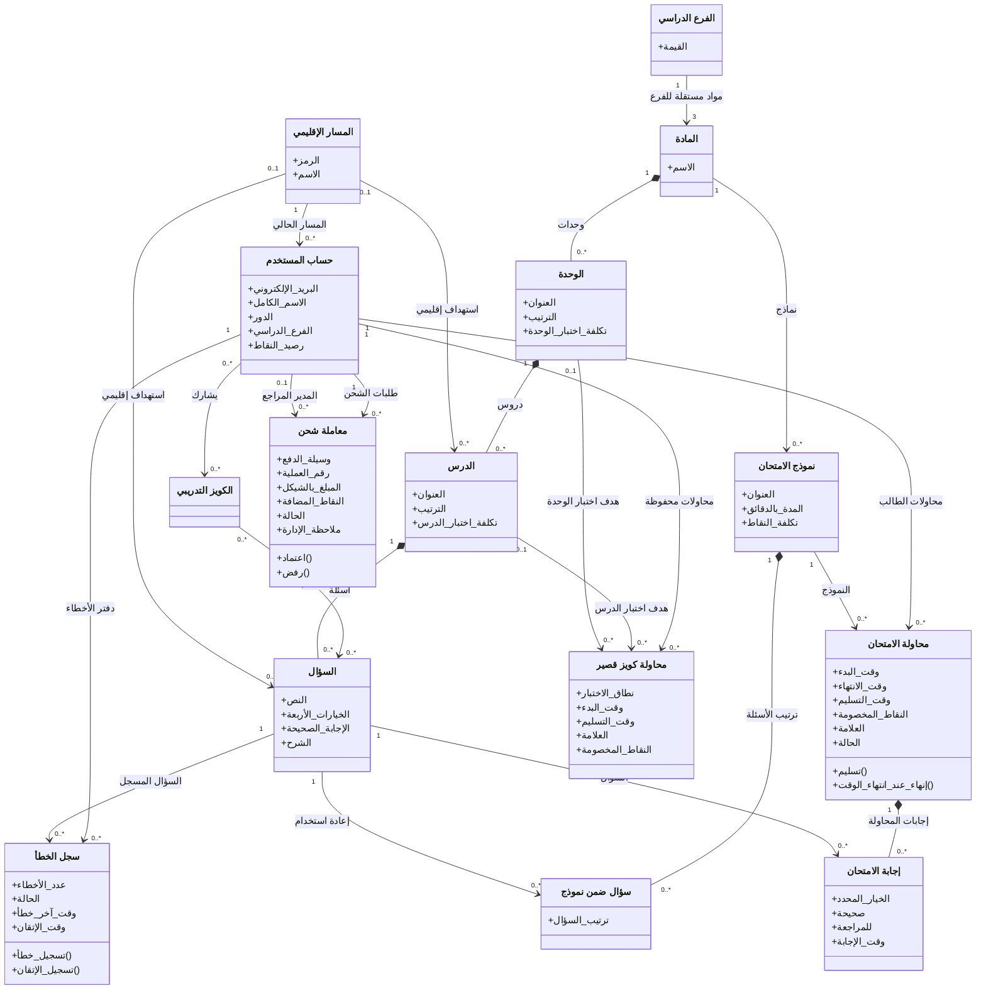

# مخطط الفئات — تصميم مفاهيمي لـ MVP

## الغرض

تحويل مفاهيم العمل الموثقة إلى فئات تصميمية ذات خصائص وعلاقات، مع إظهار الفرق بين ما تؤكده المتطلبات وما بقي اقتراحاً في نموذج البيانات.

## مصادر المتطلبات

- PRD: الأقسام 8–11 و15–17، FR-001–FR-033، BR-001–BR-013، وAC-001–AC-009.
- ERD/DBML: جميع الكيانات والحقول والعلاقات والقيود الموثقة.
- تدفق المستخدم: الأدوار، مراجعة الشحن، ومحاولة الامتحان.

## الرسم

## الشرح والتحقق

- `User` يمثل حساباً له دور طالب أو مدير؛ المدير هو أيضاً المستخدم الذي قد يراجع معاملة شحن. لا تُنشأ فئة معلم منفصلة لأن صلاحياته غير منفصلة عن دور المدير في المصادر.
- بنية المنهاج متدرجة، ويستهدف كل درس أو سؤال منطقة اختيارية. ترتبط الأسئلة بنماذج الامتحانات من خلال فئة الربط `ExamQuestion` التي تحمل ترتيب السؤال.
- لكل فرع ثلاثة سجلات مواد مستقلة: الرياضيات واللغة الإنجليزية واللغة العربية، أي ستة سجلات إجمالاً. يمثل ارتباط `Stream` بحقل `subjects.stream` في DBML، ولكل سجل شجرته الخاصة.
- تحفظ `ExamAttempt` وقت البدء والانتهاء والحالة والنقاط المصروفة، وتسجل `ExamAnswer` اختيار الطالب وعلامة المراجعة. يستأنف الطالب المحاولة النشطة للنموذج نفسه دون خصم جديد؛ ويمكن تحديث الإجابة قبل `ends_at`، ويُحتسب آخر اختيار استلمه الخادم قبل الموعد.
- تحفظ كل محاولة كويز درس أو وحدة كملخص في `QuizAttempt` فقط، وتخصم تكلفة المحاولة المدفوعة عند البدء. لا تحفظ إجابات الكويز المفردة على الخادم؛ محاولات الزائر المجانية تحفظ محلياً.
- مجانية الدرس الأول والثاني مشتقة من ترتيبهما في الوحدة ولا تخزن كخاصية؛ كما أن ترتيب الدروس فريد داخل الوحدة.
- سجل الخطأ يربط الطالب بالسؤال ويدعم عداد الأخطاء وحالتي النشط والمتقن. معاملة الشحن ترتبط بالطالب وبمدير مراجع اختياري، وتوثق وسيلة الدفع والمبلغ والنقاط والحالة.
- طلب الشحن المرفوض يعاد إرساله بتعديل السجل نفسه مع الحفاظ على معرّفه. المراجعة من لوحة التحكم بعد تسجيل دخول المدير، وتيليجرام للإشعار فقط.
- عند فشل تحميل أسئلة الامتحان، تلغى المحاولة وتُرد النقاط فقط إذا أُنشئت في طلب البدء الحالي ولم تكن لها إجابات محفوظة؛ فشل التحميل لمحاولة مستأنفة أو لها إجابات محفوظة لا يلغيها ويسمح بإعادة المحاولة.
- الوسائل المنطقية مثل Google OAuth وبوت تيليجرام ليست فئات مجال، ولا تُضاف هنا كخدمات أو مكونات تقنية.
- تعددية المحتوى الموجه اختيارية حسب DBML؛ علاقات المستخدم ونماذج الامتحان والروابط الأساسية تطابق ERD.
- `تسليم()` و`إنهاء_عند_انتهاء_الوقت()` وعمليات تسجيل الخطأ والاعتماد/الرفض هي عمليات مجال واردة في PRD وليست واجهات API أو تفاصيل تنفيذ.

## ما هو مؤكد وما هو تمثيل تصميمي؟

- الفئات والعلاقات الصلبة وخصائصها الأساسية مؤكدة في PRD وERD/DBML.
- `Stream` مفهوم وتمثيل لقيمة التعداد `stream_type`، وليس جدولاً مستقلاً؛ ترتبط به ثلاثة سجلات مواد مستقلة في كل فرع.
- `QuizAttempt` وعلاقاته مؤكدة لتمثيل محاولات الكويز المخزنة. يجب أن يطابق `quiz_type` تحديد واحد فقط من الدرس أو الوحدة.
- يظهر الفرع الدراسي ضمن خصائص المستخدم كما يصف PRD، لكن DBML يسمح بأن يكون فارغاً. إلزامه سؤال مفتوح، وليس قيداً جديداً في هذا الرسم.
- يعرض الرسم رصيد النقاط على `User` كما في DBML؛ لا يقترح جدول محفظة منفصلاً.

## الافتراضات

- المعرّف والدلالة التقنية للمفتاح الأساسي/الأجنبي حذفا من الرسم عمداً؛ هذا مخطط تصميمي لا بديل عن DBML.
- عمليات الفئات تمثل مسؤوليات عمل مفاهيمية فقط. المسؤولية الدقيقة بين الخادم والكيانات/الخدمات لم تُحسم في الوثائق.
- لا تملك محاولة الكويز القصير حقول إجابات مفصلة في نموذج البيانات الحالي؛ لم تُضف فئة إجابة لها.

## الأسئلة المفتوحة

- هل يجب أن يكون `stream` إلزامياً للمستخدم المسجل؟
- هل يدعم سجل الأخطاء المحلي للزائر خصائص مماثلة للسجل السحابي، وكيف يندمج عند التسجيل؟ تفاصيل الدمج موثقة وظيفياً، لكن نموذج الكيانات المحلية غير محدد.
