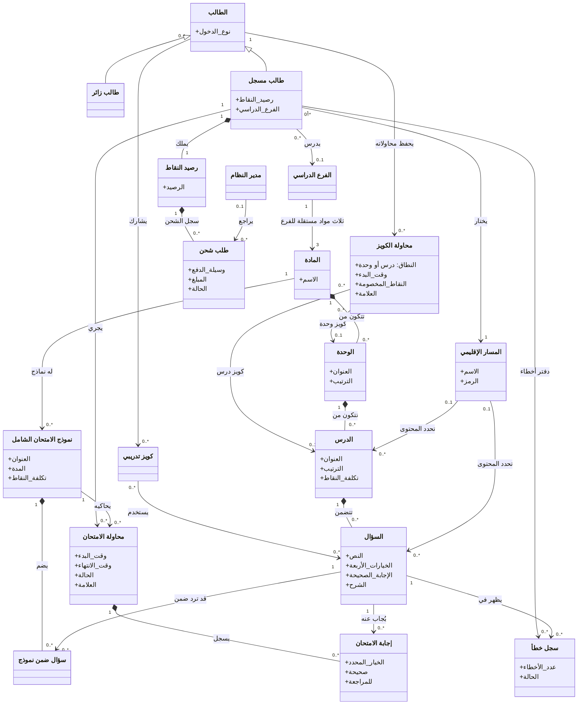

# مخطط المجال — سند توجيهي

## الغرض

عرض المفاهيم التجارية الرئيسية في المنتج وعلاقاتها وتعددية ارتباطها، بمعزل عن أسماء جداول قاعدة البيانات أو تفاصيل التنفيذ.

## مصادر المتطلبات

- PRD: أقسام 5 و7–11 و15–16، والمتطلبات FR-005–FR-033 وقواعد الأعمال BR-001–BR-013.
- تدفق المستخدم: «تحليل المتطلبات المؤكدة» و«قواعد الأعمال ذات الصلة».
- ERD/DBML: بنية المنهاج والأسئلة والامتحانات والمحاولات والأخطاء والمحفظة، للتأكد من العلاقات فقط.

## الرسم

## الشرح والتحقق

- يختار الطالب المسار الإقليمي الذي يحدد المحتوى المناسب. ويعرض الرسم المنطقة المستهدفة للمحتوى اختيارية لأن غيابها يعني أن المحتوى متاح لكل المناطق.
- يتدرج المنهاج من المادة إلى الوحدة فالدرس فالسؤال. وللمادة نماذج امتحان ثابتة؛ ويتيح مفهوم «سؤال ضمن نموذج» إعادة استخدام السؤال وترتيبه داخل النموذج.
- لكل فرع ثلاث سجلات مواد مستقلة: الرياضيات واللغة الإنجليزية واللغة العربية؛ المجموع ستة سجلات، ولكل سجل شجرته الخاصة من الوحدات والدروس والأسئلة.
- أول درسين في كل وحدة مجانيان بحسب ترتيب الدرس؛ المجانية مشتقة ولا تخزن كحقل. ترتيب الدرس فريد داخل الوحدة.
- تحفظ كل محاولة كويز درس أو وحدة كملخص للمحاولة فقط؛ لا تحفظ إجابات الكويز المفردة على الخادم. تخصم تكلفة المحاولة المدفوعة عند بدئها، ومحاولات الزائر المجانية تحفظ محلياً.
- كل محاولة امتحان تخص طالباً مسجلاً ونموذجاً واحداً، وتسجل إجابات الأسئلة. يستأنف الطالب المحاولة النشطة للنموذج نفسه دون إنشاء محاولة أو خصم جديد. يحفظ الخادم الاختيار عند استلامه ويحتسب آخر اختيار قبل `ends_at`.
- قد يملك الطالب سجلات أخطاء متعددة، واحداً لكل سؤال غير متقن، ورصيداً وطلبات شحن متعددة. يراجع المدير طلبات الشحن بعد تسجيل الدخول إلى لوحة التحكم؛ تيليجرام للإشعار فقط، ولا يضيف الاعتماد النقاط إلا بعد مراجعة المدير. يُعاد إرسال الطلب المرفوض بتعديل السجل نفسه.
- عند فشل تحميل أسئلة الامتحان، تلغى المحاولة وتُرد النقاط فقط إذا أُنشئت في طلب البدء الحالي ولم تكن لها إجابات محفوظة؛ فشل التحميل لمحاولة مستأنفة أو لها إجابات محفوظة لا يلغيها ويسمح بإعادة المحاولة.
- الزائر يستطيع التصفح والكويز المجاني، لكن PRD لا يقرر له حساباً دائماً؛ لذلك لم يُربط بسجل محاولات أو رصيد سحابي.
- التعددية 0..* تعبر عن إمكان عدم وجود سجلات أو محتوى بعد. قيد السؤال الفريد في نموذج الامتحان وقيد سجل الخطأ للمستخدم والسؤال موضحان في ERD/DBML ولا يكررهما الرسم.
- هذا رسم مفاهيمي وليس مخطط جداول. «رصيد النقاط» مفهوم تجاري مخزن حالياً ضمن المستخدم، وليس ادعاءً بوجود جدول محفظة مستقل.

## الافتراضات

- عومل الطالب المسجل والمدير كنوعين من المستخدمين/الممثلين، مع كون الدور المخزن في DBML قيمة `student` أو `admin`.
- مفهوم «سؤال ضمن نموذج» يشرح علاقة N:M وترتيب السؤال، لكنه لا يفترض خوارزمية اختيار أسئلة جديدة.
- لم يُرسم ولي الأمر كفاعل أو علاقة؛ لم تحدد وثائق MVP وظيفة له.

## الأسئلة المفتوحة

- حقل الفرع الدراسي في DBML اختياري، بينما التدفق يطلب اختيار الفرع. هل يجب أن يكون إلزامياً لحساب الطالب؟
- هل يحتاج ولي الأمر في MVP إلى حساب مستقل أو صلاحيات متابعة؟ وثائق الجمهور المستهدف لا تحدد ذلك.
