# مخطط التسلسل — بدء امتحان شامل وتسليمه

## الغرض

إظهار الرسائل والتحققات اللازمة لعملية الامتحان الشامل، مع استئناف المحاولة النشطة ومسارات الشحن والإلغاء والنتائج.

## مصادر المتطلبات

- PRD: FR-009–FR-020 وFR-023 وFR-027–FR-033 وBR-001–BR-013 وNFR-003، وEC-001–EC-003، وAC-002 وAC-004–AC-009.
- تدفق المستخدم: «الامتحان الشامل الموقوت» و«شحن رصيد النقاط».
- ERD/DBML: محاولات الامتحان وإجاباته ومعاملات المحفظة وحالاتها ومفاتيحها الفريدة.

## الرسم

```mermaid
sequenceDiagram
    autonumber
    actor Student as الطالب
    participant Web as تطبيق الويب
    participant Server as الخادم
    participant DB as قاعدة البيانات
    participant Telegram as بوت تيليجرام
    actor Admin as مدير النظام

    Student->>Web: طلب بدء نموذج امتحان
    Web->>Server: إرسال طلب البدء وهوية الطالب والنموذج
    Server->>DB: إقفال محاولة هذا الطالب لهذا النموذج إذا بلغت ends_at بالحالة expired
    DB-->>Server: تأكيد إقفال المحاولات المنتهية
    Server->>DB: البحث عن محاولة in_progress للنموذج نفسه
    DB-->>Server: المحاولة النشطة إن وجدت

    alt توجد محاولة نشطة
        Server-->>Web: إعادة بيانات المحاولة النشطة ووقت الانتهاء
        Web-->>Student: استئناف دون خصم أو إنشاء محاولة جديدة
    else لا توجد محاولة نشطة
        Server->>DB: قراءة تكلفة النموذج ورصيد الطالب
        DB-->>Server: points_cost والرصيد الحالي
        alt الرصيد كافٍ
            Server->>DB: معاملة ذرية: خصم points_cost وإنشاء محاولة
            DB-->>Server: معرّف المحاولة ووقت الانتهاء
        else الرصيد غير كافٍ
            Server-->>Web: بيان التكلفة والرصيد وخيار الشحن
            Web-->>Student: متابعة الشحن أو إلغاءه
            alt إلغاء الشحن أو عدم المتابعة
                Note over Student,Web: لا يبدأ الامتحان؛ ينتهي هذا المسار دون إنشاء محاولة.
            else متابعة الشحن
                loop لكل طلب جديد أو إعادة إرسال حتى الاعتماد أو توقف الطالب
                    Student->>Web: إدخال وسيلة الدفع والمبلغ ورقم العملية
                    Web->>Server: إرسال الطلب وبيانات الإيصال الاختياري
                    Server->>Server: التحقق من نوع الإيصال وحجمه إن أُرفق
                    Server->>DB: فحص تكرار (payment_method, transaction_id) مع استثناء السجل الجاري تصحيحه
                    alt الإيصال غير صالح أو رقم العملية مكرر
                        Server-->>Web: رفض البيانات وبيان سبب الخطأ
                        Web-->>Student: تصحيح البيانات أو التوقف؛ لا يعود الطلب إلى pending
                    else البيانات صالحة
                        alt إعادة إرسال طلب مرفوض
                            Server->>DB: تحديث السجل نفسه إلى pending مع الحفاظ على معرّفه
                        else طلب شحن جديد
                            Server->>DB: حفظ طلب الشحن الجديد بحالة pending
                        end
                        DB-->>Server: تأكيد حفظ الطلب قيد المراجعة
                        Server->>Telegram: إشعار بوصول الطلب فقط
                        Telegram-->>Admin: تنبيه بوصول الطلب للمراجعة
                        Admin->>Web: تسجيل الدخول إلى لوحة التحكم ومراجعة الطلب
                        Web->>Server: إرسال قرار المدير من لوحة التحكم
                        alt اعتماد الطلب
                            Server->>DB: اعتماد المعاملة وإضافة نقاط الباقة
                            DB-->>Server: تأكيد الحالة والرصيد الجديد
                            Server-->>Web: تأكيد الشحن
                            Web-->>Student: عرض نجاح الشحن
                        else رفض الطلب
                            Server->>DB: حفظ الرفض وملاحظة الإدارة في السجل نفسه
                            DB-->>Server: تأكيد تحديث السجل
                            Server-->>Web: حالة الرفض وسببه
                            Web-->>Student: تصحيح السجل نفسه وإعادة الإرسال أو التوقف
                            Note over Student,Web: إعادة الإرسال تعود إلى بداية الدورة وتخضع للتحقق من الإيصال والتكرار مجدداً.
                        end
                    end
                end
                opt تم اعتماد الشحن ومتابعة الطالب للامتحان
                    Server->>DB: إقفال محاولة هذا الطالب لهذا النموذج إذا انتهت ثم البحث عن محاولة نشطة
                    DB-->>Server: نتيجة الفحص ورصيد الطالب
                    alt ظهرت محاولة نشطة أثناء الشحن
                        Server-->>Web: بيانات المحاولة القائمة
                        Web-->>Student: استئناف دون خصم نقاط
                    else لا توجد محاولة نشطة والرصيد كافٍ
                        Server->>DB: معاملة ذرية: خصم points_cost وإنشاء محاولة
                        DB-->>Server: معرّف المحاولة ووقت الانتهاء
                    end
                end
            end
        end
    end

    opt توجد محاولة مستأنفة أو أُنشئت في طلب البدء الحالي
        Server->>DB: تحميل أسئلة المحاولة دون الإجابات الصحيحة
        alt فشل تحميل الأسئلة
            alt أنشئت المحاولة في طلب البدء الحالي ولا توجد إجابات محفوظة
                Server->>DB: إلغاء المحاولة ورد النقاط تلقائياً
                DB-->>Server: تأكيد الإلغاء والاسترداد
                Server-->>Web: إلغاء المحاولة وإبلاغ الطالب باسترداد النقاط
                Web-->>Student: عرض إلغاء المحاولة واسترداد النقاط
            else محاولة مستأنفة أو توجد إجابات محفوظة
                Server-->>Web: خطأ تحميل دون إلغاء المحاولة أو استرداد النقاط
                Web-->>Student: إتاحة إعادة محاولة تحميل الأسئلة
                loop إعادة المحاولة ما دامت المحاولة مفتوحة والطالب يواصل
                    Student->>Web: طلب إعادة تحميل الأسئلة
                    Web->>Server: إعادة طلب التحميل للمحاولة نفسها
                    Server->>DB: إعادة تحميل الأسئلة
                    alt ما زال التحميل فاشلاً
                        Server-->>Web: إبلاغ بفشل التحميل وإتاحة المحاولة مجدداً
                        Web-->>Student: عرض الخطأ دون إلغاء أو استرداد
                    else تم تحميل الأسئلة
                        Server-->>Web: الأسئلة ووقت الانتهاء دون الإجابات الصحيحة
                        Web-->>Student: عرض الامتحان والمؤقت
                    end
                end
            end
        else تم تحميل الأسئلة
            Server-->>Web: الأسئلة ووقت الانتهاء دون الإجابات الصحيحة
            Web-->>Student: عرض الامتحان والمؤقت
        end

        opt لم تُلغَ المحاولة وحُمّلت الأسئلة بنجاح
            loop لكل إجابة أو تغيير يصل قبل ends_at
                Student->>Web: اختيار إجابة أو تغييرها أو وضع علامة للمراجعة
                Web->>Server: حفظ الاختيار أو علامة المراجعة فوراً
                Server->>Server: رفض ما يصل عند ends_at أو بعده
                Server->>DB: تحديث الاختيار المستلم قبل ends_at
                DB-->>Server: تأكيد حفظ آخر اختيار
                Server-->>Web: تأكيد التسجيل
            end

            alt تسليم يدوي مؤكد يصل قبل ends_at
                Student->>Web: طلب التسليم ثم تأكيده
                Web->>Server: توثيق التسليم
                Server->>DB: إقفال المحاولة وتقييم آخر إجابة مستلمة لكل سؤال
                Server->>DB: تحديث سجلات الأخطاء والإحصائيات
                DB-->>Server: النتيجة وسجلات المراجعة
                Server-->>Web: العلامة والإجابات والتفسيرات
                Web-->>Student: عرض النتيجة والمراجعة
            else بلغ مؤقت الخادم ends_at أولاً
                Server->>DB: إقفال المحاولة بالحالة expired قبل تقييمها
                Server->>DB: تقييم الإجابات المستلمة قبل ends_at فقط
                DB-->>Server: النتيجة النهائية
                Server-->>Web: حالة الانتهاء والنتيجة
                Web-->>Student: عرض النتيجة عند توفر الاتصال
            end
        end
    end
```

## الشرح والتحقق

- قبل فحص المحاولة النشطة لمعالجة طلب بدء، يقفل الخادم أي محاولة للنموذج نفسه بلغت `ends_at` بحالة `expired`؛ لذلك لا تحجب المحاولة المنتهية بدء محاولة جديدة.
- إذا وجدت محاولة نشطة، يستأنفها الطالب دون إنشاء محاولة أو خصم جديد. عند عدم وجودها، ينشئ الخادم محاولة جديدة بعد التحقق من الرصيد وخصم `points_cost`.
- إذا لم يكف الرصيد، يمكن للطالب إلغاء مسار الشحن دون بدء الامتحان. كل طلب شحن جديد أو إعادة إرسال لطلب مرفوض يخضع للتحقق من نوع الإيصال وحجمه إن أُرفق، ومن عدم تكرار `(payment_method, transaction_id)` لدى معاملة أخرى. لا ينتقل طلب مرفوض إلى `pending` إلا بعد نجاح التحقق، ويظل معرّفه كما هو.
- تيليجرام للإشعار فقط؛ يراجع المدير الطلب من لوحة التحكم بعد تسجيل الدخول، ولا تُضاف النقاط إلا بعد الاعتماد.
- عند فشل تحميل الأسئلة، لا تُلغى المحاولة ولا تُرد النقاط إلا إذا أُنشئت المحاولة في طلب البدء الحالي ولا توجد إجابات محفوظة. إذا كانت المحاولة مستأنفة، أو وُجدت إجابات محفوظة، يعرض النظام الخطأ ويتيح إعادة التحميل دون إلغاء أو استرداد.
- يحفظ الخادم اختيار الإجابة وعلامة المراجعة فور استلامهما. يسمح بتغيير الاختيار قبل `ends_at`، ويحتسب آخر اختيار وصل قبله فقط.
- يتطلب التسليم اليدوي تأكيداً واتصالاً لتوثيقه. عند بلوغ `ends_at` يقفل الخادم المحاولة بالحالة `expired` ثم يقيّم الإجابات التي استلمها قبل الموعد.
- المشاركون جهات منطقية وردت في PRD: تطبيق الويب والخادم وقاعدة البيانات وبوت تيليجرام والطالب والمدير؛ لا يفترض الرسم إطاراً أو مزود قاعدة بيانات.

## الافتراضات

- «الخادم» و«قاعدة البيانات» مشاركان منطقيان؛ لا يحسم PRD البنية أو المنتج التقني.
- تحديث سجل الخطأ عند الإجابة الخاطئة في الامتحان يستند إلى FR-016. يظل مفتاح الإجابة مخفياً حتى التقييم.
- لا يصور التسلسل تسجيل الدخول للطالب، إذ يبدأ بطالب مسجل؛ تسجيل الدخول بالبريد أو Google موثق في تدفق آخر.
- تسليم الطالب يحتاج اتصالاً لتوثيقه. إذا انقطع الاتصال، يستمر المؤقت على الخادم، وتُعرض النتيجة عند توفر الاتصال.

## الأسئلة المفتوحة

- ما سلوك المزامنة إذا انتهى المؤقت أثناء انقطاع الاتصال بينما يواصل الطالب التفاعل محلياً؟
- كيف يحسم الخادم طلب إجابة وصل بالتزامن مع `ends_at`؟
