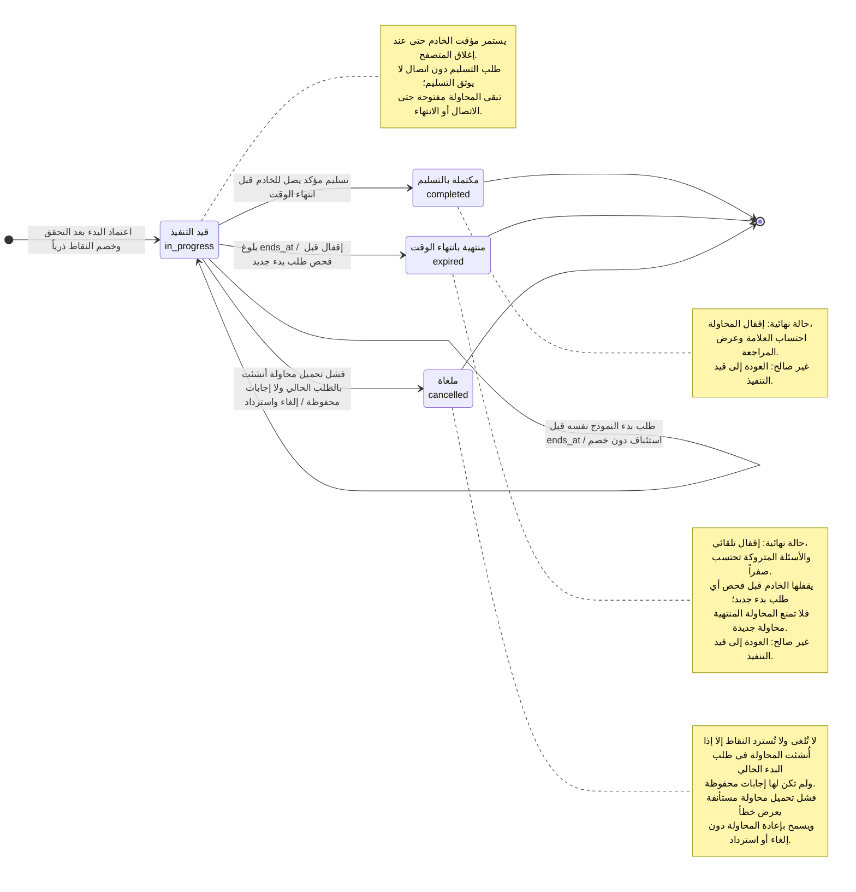

# مخطط الحالات — دورة حياة محاولة الامتحان الشامل

## الغرض

تحديد حالات محاولة الامتحان وانتقالاتها المؤكدة، بما فيها الإلغاء التلقائي واسترداد النقاط عند فشل تحميل الأسئلة بعد الخصم.

## مصادر المتطلبات

- PRD: FR-009–FR-012 وFR-028–FR-030، BR-005–BR-009 وBR-011، وAC-002 وAC-008 وEC-001–EC-003.
- تدفق المستخدم: «الامتحان الشامل الموقوت» و«نقاط القرار».
- ERD/DBML: `exam_attempts.status` بالقيم `in_progress`, `completed`, `expired`, `cancelled`، وحقلا `started_at` و`ends_at` و`submitted_at`.

## الرسم

## الشرح والتحقق

- تبدأ المحاولة بحالة `in_progress` بعد تحقق الخادم من الصلاحية والرصيد وخصم النقاط وإنشاء المحاولة. إذا طلب الطالب بدء النموذج نفسه والمحاولة ما زالت نشطة، يستأنفها النظام ويبقيها بالحالة ذاتها دون خصم إضافي.
- ينتقل المسار إلى `completed` إذا وثّق الخادم تسليماً مؤكداً قبل انتهاء الوقت. الإنهاء النهائي والتقييم يمنعان مواصلة المحاولة.
- ينتقل المسار إلى `expired` عند بلوغ `ends_at`؛ يقفل الخادم المحاولة قبل فحص أي طلب بدء جديد، وتحتسب الإجابات المتروكة صفراً.
- ينتقل المسار إلى `cancelled` عند فشل تحميل أسئلة محاولة أُنشئت في طلب البدء الحالي ولم تُحفظ لها إجابات؛ تُلغى وتُرد النقاط. فشل التحميل لمحاولة مستأنفة أو محاولة لها إجابات محفوظة لا ينقلها إلى `cancelled`، بل يعرض خطأ ويسمح بإعادة المحاولة.
- الحالات `completed` و`expired` و`cancelled` نهائية. لا يوجد انتقال لإعادة فتح محاولة مقفلة.
- فشل إرسال التسليم بسبب انقطاع الشبكة ليس انتقالاً لحالة نهائية. يظل التسليم غير موثق، لكن مؤقت الخادم يستمر، ولذلك يمكن أن تنتهي المحاولة تلقائياً.
- «تسليم مؤكد يصل للخادم قبل انتهاء الوقت» يضم تأكيد الطالب المذكور في AC-002 والتحقق الخادمي المطلوب؛ لا يكفي النقر المحلي وحده.

## الافتراضات

- تعامل `completed` و`expired` و`cancelled` كحالات نهائية بعد القفل أو الإلغاء.
- ربط `expired` ببلوغ `ends_at` و`completed` بالتسليم اليدوي يتبع حالتي DBML وسلوك المؤقت الموثق.

## الأسئلة المفتوحة

- ما النتيجة المعروضة إذا انتهى الوقت أثناء انقطاع الاتصال، ومتى تُتاح للطالب؟
- هل يمكن لعملية تسليم وصلت بالتزامن مع انتهاء الوقت أن تنتج حالة `completed`؟ قاعدة الحسم غير موثقة.
