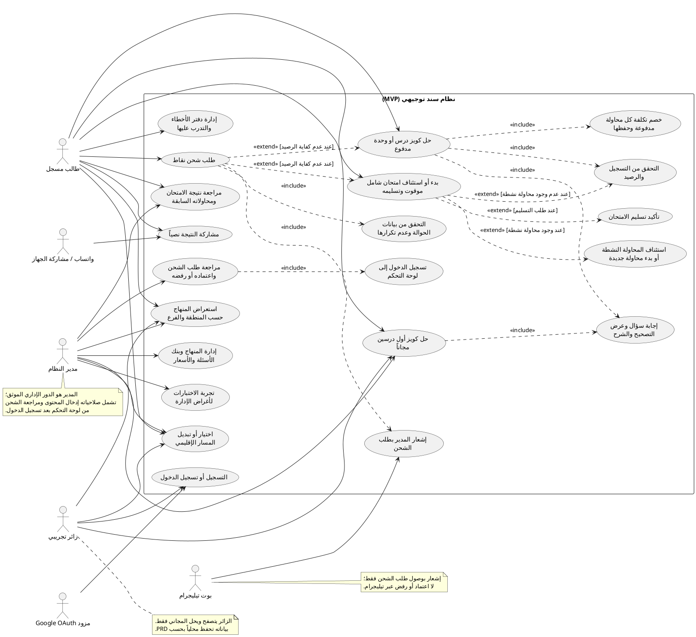

# مخطط حالات الاستخدام — سند توجيهي

## الغرض

تحديد ممثلي النظام الرئيسيين والثانويين ووظائف MVP الموثقة، مع إظهار حدود النظام والعلاقات بين حالات الاستخدام عند وجود اعتماد فعلي.

## مصادر المتطلبات

- PRD: الأقسام 5 و8–11 و14–17، والأدوار والصلاحيات، والتكاملات.
- تدفق المستخدم: تدفق التدريب والشحن والامتحان، وتحليل المتطلبات المؤكدة.
- ERD/DBML: حالات محاولات الامتحان ومعاملات المحفظة ومستخدم المدير.

## الرسم (PlantUML)

## الشرح والتحقق

- الممثلون الأساسيون هم الزائر والطالب المسجل والمدير. لكل منهم وظائفه كما في جدول الصلاحيات في PRD.
- تشمل حالة الكويز الإجابة والتصحيح والشرح؛ لذلك يدرجها كل من الكويز المجاني والمدفوع. يختبر المدير الاختبارات لأغراض الإدارة، ولا يُفترض أن تنطبق عليه شروط نقاط الطالب.
- Google OAuth وبوت تيليجرام ممثلان ثانويان لأن PRD يذكرهما كتدخلين خارجيين صريحين. لا يُمثل مزود دفع خارجياً؛ الدفع في MVP يدوي والمطابقة بيد المدير.
- التحقق من التسجيل والرصيد جزء إلزامي من فتح الاختبار المدفوع. وإذا لم يكف الرصيد، يمكن أن يبدأ الطالب طلب شحن؛ لذلك يظهر الشحن امتداداً مشروطاً لا خطوة إلزامية لكل امتحان. أما مراجعة المدير فهي متابعة لاحقة مستقلة للطلب.
- التحقق من بيانات الشحن وإشعار المدير مشمولان بطلب الشحن. المراجعة الإدارية لا تحدث إلا بعد إرسال الطلب.
- كل محاولة كويز مدفوعة تُخصم تكلفتها وتُحفظ. ويحفظ النظام محاولات الكويز المجانية للزائر محلياً.
- طلب بدء امتحان لنموذج له محاولة نشطة يستأنفها ولا ينشئ محاولة أخرى أو يخصم نقاطاً جديدة.
- إعادة إرسال طلب شحن مرفوض تعدّل السجل نفسه وتحافظ على معرّفه.
- مشاركة النتيجة مرتبطة بواجهة المشاركة/واتساب المذكورة في PRD. لم يُضف ولي الأمر كممثل لأن الوثائق لا تمنحه حالة استخدام أو صلاحية محددة في MVP.
- لم يُضف Include/Extend لمجرد التصنيف؛ العلاقات المرسومة تصف اعتماداً أو شرطاً موثقاً.

## الافتراضات

- يفترض بدء حالات الاستخدام المدفوعة وجود تسجيل دخول صالح؛ ويتم التحقق من ذلك ضمن أهلية الاستخدام. خيار التسجيل بالبريد أو Google موثق، لكن مزود OAuth فقط ممثل كجهة خارجية.
- يعامل المدير ممثلاً واحداً يملك صلاحيات إدارة المحتوى ومراجعة الشحن؛ لا توجد أدوار منفصلة مؤكدة لمعلم أو مدقق.
- المقصود بـ «مشاركة الجهاز» هو Web Share API أو رابط واتساب المذكوران في PRD، لا تكامل مخصص غير موثق.

## الأسئلة المفتوحة

- ولي الأمر ضمن الجمهور المستهدف، لكن هل يحتاج إلى حالات استخدام أو حساب مستقل في MVP؟
- يصف PRD بعض وظائف المدير بأنها «إضافة وتعديل» وأخرى بأنها تعديل تكلفة ومجانية؛ هل تشمل إدارة نماذج الامتحان أيضاً؟
- هل كويز الأخطاء يُعامل كحالة استخدام مستقلة عن التدريب، وهل تحفظ محاولاته؟
