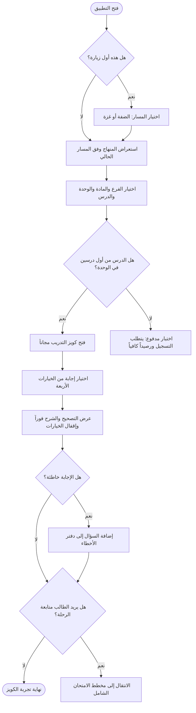
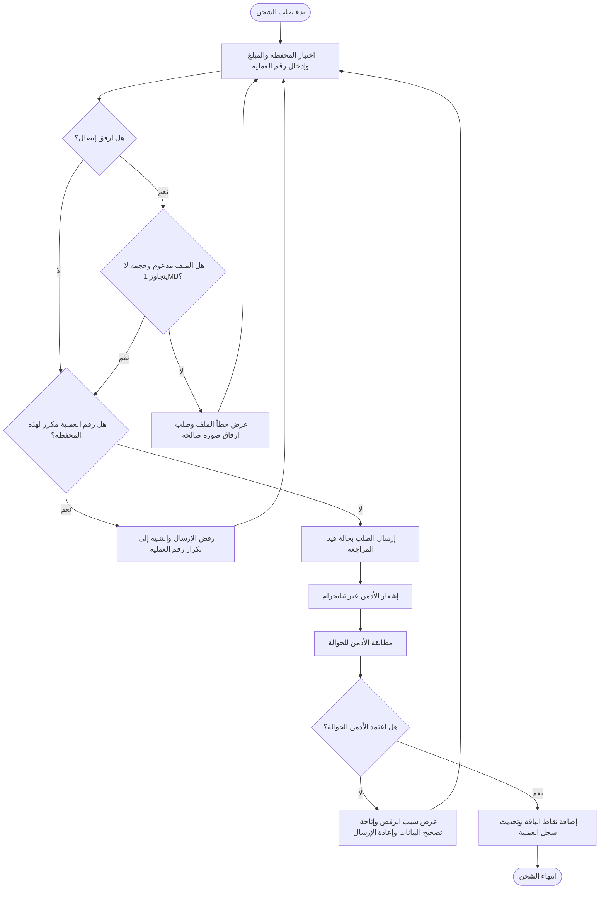
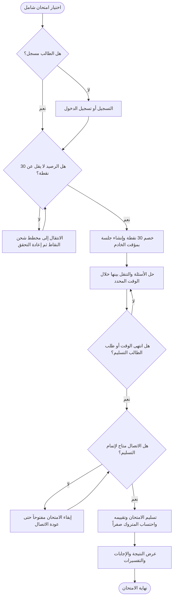

# تدفق المستخدم الرئيسي — تجربة التدريب ثم فتح امتحان شامل

## الدور الرئيسي

طالب التوجيهي، كزائر تجريبي في بداية الرحلة ثم كطالب مسجل عند طلب اختبار مدفوع. يشارك مدير النظام في مراجعة طلب الشحن واعتماده أو رفضه.

## هدف التدفق

تمكين الطالب من اختيار مساره التعليمي، تجربة كويز درس مجاني مع التصحيح والشرح الفوري، ثم التسجيل وشحن النقاط عند رغبته في فتح امتحان شامل مدفوع، وإكمال الامتحان حتى ظهور النتيجة.

## تحليل المتطلبات المؤكدة

- **المستخدمون والأدوار:** زائر تجريبي، طالب مسجل، مدير النظام/مدخل المحتوى. ولي الأمر ضمن المستخدمين المستهدفين لتمويل الطالب ومتابعة علاماته، لكنه ليس طرفاً في تدفق MVP المختار.
- **الميزات ذات الصلة:** تخصيص المسار الإقليمي، فهرس المنهاج، كويز التدريب، التسجيل، محفظة النقاط والشحن اليدوي، مراجعة الأدمن، والامتحان الشامل الموقوت.
- **هدف الطالب:** تجربة الأسئلة والشروحات مجاناً، ثم التدرب في امتحان شامل يحاكي الامتحان الوزاري.
- **الدخول والخروج:** يبدأ التدفق عند فتح التطبيق. يمكن أن ينتهي بعد تجربة الكويز المجاني؛ وإذا اختار الطالب متابعة الرحلة المدفوعة، ينتهي بعد تسليم الامتحان وعرض النتيجة. مسار النتيجة مدعوم بمعيار القبول AC-002.
- **الإجراءات:** اختيار المسار والمنهاج، فتح درس، إجابة سؤال، التسجيل، اختيار وسيلة الشحن وإدخال بيانات الحوالة، مراجعة الأدمن، بدء الامتحان وتسليمه.
- **التحقق:** التحقق من تسجيل الطالب للاختبارات المدفوعة، كفاية الرصيد، عدم تكرار مفتاح (المحفظة + رقم العملية)، وصحة/حجم ملف الإيصال إن أُرفق. تُنفّذ عمليات الخصم والدرجات على الخادم.
- **النتائج:** تصحيح فوري وشرح؛ إضافة الإجابة الخاطئة لدفتر الأخطاء؛ اعتماد الحوالة يضيف نقاطها؛ رفضها يعرض السبب ويسمح بإعادة الإرسال؛ وتسليم الامتحان يعرض النتيجة والتفسيرات.

## مخططات Mermaid

قُسّم التدفق لتسهيل قراءته. عند الانتقال بين المخططات، يبدأ كل مخطط من النقطة الموضحة في عنوانه.

### 1. تجربة كويز التدريب

### 2. شحن رصيد النقاط

يبدأ هذا المخطط عندما يختار الطالب الشحن، مثلًا بعد ظهور تنبيه عدم كفاية الرصيد.

### 3. الامتحان الشامل الموقوت

يبدأ هذا المخطط عند اختيار امتحان شامل. إذا لم يكف الرصيد، ينتقل الطالب إلى مخطط شحن النقاط ثم يعيد التحقق.

## شرح التدفق بالعربية

### الرحلة الرئيسية

يفتح الطالب التطبيق، ويختار في أول زيارة مسار الضفة الغربية أو قطاع غزة. بعد استعراض المنهاج الخاص بالمسار، يختار الفرع والمادة والوحدة والدرس. إذا كان الدرس من أول درسين في الوحدة، يستطيع الزائر أو الطالب حل كويزه مجاناً. وإذا كان الدرس مدفوعاً، يلزم تسجيل الطالب وتوفر رصيد كافٍ. A([فتح التطبيق]) --> B{هل هذه أول زيارة؟}
    B -->|نعم| C[اختيار المسار: الضفة الغربية أو قطاع غزة]
    B -->|لا| D[استعراض المنهاج وفق المسار الحالي]
    C --> D
    D --> E[اختيار الفرع والمادة والوحدة والدرس]
    E --> F{هل الدرس ضمن أول درسين في الوحدة؟}
    F -->|نعم| G[فتح كويز التدريب مجاناً دون خصم نقاط]
    F -->|لا| H{هل الطالب مسجل؟}
    H -->|لا| I[التسجيل أو تسجيل الدخول]
    H -->|نعم| J{هل الرصيد يكفي لتكلفة الكويز؟}
    I --> J
    J -->|لا| K[عرض أن الرصيد غير كافٍ وتوجيه الطالب إلى المحفظة]
    J -->|نعم| L[خصم تكلفة الكويز على الخادم وفتح الكويز]
    K --> M[اختيار المحفظة والمبلغ وإدخال رقم العملية]
    M --> N{هل الإيصال المرفق صالح وحجمه لا يتجاوز 1MB؟}
    N -->|لا| N1[عرض خطأ الملف وطلب إرفاق صورة مدعومة بالحجم المحدد]
    N1 --> M
    N -->|نعم أو لا يوجد مرفق| O{هل رقم العملية مكرر لنفس المحفظة؟}
    O -->|نعم| O1[رفض الإرسال والتنبيه إلى أن رقم العملية أُرسل سابقاً]
    O1 --> M
    O -->|لا| P[إرسال طلب الشحن بحالة قيد المراجعة]
    P --> Q[إشعار الأدمن فوراً عبر تيليجرام]
    Q --> R[مطابقة الأدمن للحوالة ومراجعة الطلب]
    R --> S{هل اعتمد الأدمن الحوالة؟}
    S -->|لا| T[عرض حالة الرفض وسببه وإتاحة تصحيح البيانات وإعادة الإرسال]
    T --> M
    S -->|نعم| U[إضافة نقاط الباقة إلى رصيد الطالب وتحديث سجل العملية]
    U --> U1{هل طلب الشحن لفتح الامتحان الشامل؟}
    U1 -->|نعم| AD
    U1 -->|لا| J
    G --> V[اختيار إجابة من الخيارات الأربعة]
    L --> V
    V --> W[عرض التصحيح الفوري والشرح وإقفال خيارات السؤال]
    W --> X{هل الإجابة خاطئة؟}
    X -->|نعم| Y[إضافة السؤال تلقائياً إلى دفتر الأخطاء]
    X -->|لا| Z{هل يريد الطالب متابعة الرحلة؟}
    Y --> Z
    Z -->|لا| E1([نهاية تجربة الكويز])
    Z -->|نعم| AA[اختيار امتحان شامل مدفوع]
    AA --> AB{هل الطالب مسجل؟}
    AB -->|لا| I
    AB -->|نعم| AC{هل الرصيد لا يقل عن 30 نقطة؟}
    AC -->|لا| K
    AC -->|نعم| AD[خصم 30 نقطة ذرياً وإنشاء جلسة الامتحان ومؤقت الخادم]
    AD --> AE[حل الأسئلة والتنقل بينها أثناء الوقت المحدد]
    AE --> AF{هل انتهى الوقت أو طلب الطالب التسليم؟}
    AF -->|لا| AE
    AF -->|نعم| AG{هل الاتصال متاح لإتمام التسليم؟}
    AG -->|لا| AH[إبقاء الامتحان مفتوحاً حتى عودة الاتصال لتوثيق التسليم]
    AH --> AG
    AG -->|نعم| AI[تسليم الامتحان وتقييمه واحتساب المتروك صفراً]
    AI --> AJ[عرض النتيجة والإجابات الصحيحة والخاطئة والمتروكة والتفسيرات]
    AJ --> A

بعد اختيار إجابة، يعرض النظام التصحيح والشرح فوراً ويقفل خيارات السؤال. تُضاف الإجابة الخاطئة إلى دفتر الأخطاء. يمكن للطالب إنهاء تجربته هنا، أو المتابعة إلى امتحان شامل. يتطلب الامتحان الشامل التسجيل و30 نقطة وفق القيمة الافتراضية في متطلبات بيانات الامتحان. عند توفر الرصيد، يخصمه الخادم وينشئ جلسة بمؤقت خادم؛ وعند التسليم أو انتهاء الوقت، يعرض النظام النتيجة والتفسيرات.

### نقاط القرار

- **أول زيارة؟** اختيار المسار الإقليمي إلزامي عند الدخول الأول. في الزيارات التالية يظهر المنهاج وفق المسار الحالي، ويمكن تبديله من التطبيق.
- **هل الدرس مجاني؟** أول درسين من كل وحدة مجانيان وفق النطاق، وسعر كويز الدرس المدفوع 10 نقاط. سعر كويز الوحدة 20 نقطة.
- **هل الطالب مسجل ورصيده كافٍ؟** الاختبارات المدفوعة غير متاحة للزائر، وتحتاج رصيداً كافياً. تكلفة الامتحان الشامل الافتراضية 30 نقطة.
- **هل بيانات الشحن صالحة وغير مكررة؟** الإيصال اختياري وبحد أقصى 1MB. يمنع النظام إعادة إرسال رقم العملية نفسه للمحفظة نفسها.
- **هل اعتمد الأدمن الحوالة؟** المطابقة يدوية. الاعتماد يضيف رصيد الباقة، والرفض يعرض سببه مع خيار تصحيح البيانات وإعادة الإرسال.
- **هل انتهى الامتحان أو طلب الطالب التسليم؟** عند التسليم أو بلوغ المؤقت 00:00 يقفل الامتحان، وتُحتسب الأسئلة المتروكة بصفر.
- **هل الاتصال متاح وقت التسليم؟** حسب حالة الحافة EC-001، لا يُقفل الامتحان عند الضغط على التسليم دون اتصال؛ ينتظر استعادة الاتصال لتوثيق التسليم على الخادم.

### سيناريوهات النجاح

- الزائر يحل كويز أحد أول درسين دون إنشاء حساب أو خصم نقاط، ويرى التصحيح والشرح فوراً.
- الإجابة الخاطئة تُسجل تلقائياً في دفتر أخطاء الطالب دون إنشاء سجل مكرر للسؤال.
- الأدمن يطابق الحوالة ويعتمدها؛ يضاف رصيد الباقة، ويستطيع الطالب بدء الاختبار المدفوع.
- الطالب يسلم الامتحان أو ينتهي وقته، فتظهر النتيجة والتفسيرات وتُحدّث سجلاته وإحصائياته.

### سيناريوهات الخطأ

- **رصيد غير كافٍ:** تظهر رسالة توضح الرصيد الحالي والتكلفة المطلوبة مع توجيه لشاشة الشحن.
- **رقم حوالة مكرر:** يُرفض الطلب ويُطلب التحقق من رقم العملية.
- **حوالة مرفوضة:** تعرض المحفظة سبب الرفض، مع إمكانية تصحيح البيانات وإعادة الإرسال.
- **إيصال غير مدعوم أو أكبر من 1MB:** يظهر تنبيه الملف، ويمكن إعادة الإرفاق. الإيصال اختياري.
- **تعذر الاتصال بالخادم:** يذكر PRD رسالة لإعادة المحاولة تلقائياً. لم يُحدد تفصيل استعادة جلسة كويز التدريب بعد الانقطاع.
- **الاتصال منقطع أثناء تسليم الامتحان:** يبقى الامتحان غير مقفل إلى حين عودة الاتصال وتوثيق التسليم.

### المسارات البديلة

- يمكن للزائر إنهاء الرحلة بعد الكويز المجاني، أو إنشاء حساب للمتابعة إلى الاختبارات المدفوعة.
- قد يختار الطالب مسار الضفة أو غزة؛ المنهاج المعروض يختلف، فيما تبقى تكلفة النقاط موحدة.
- يمكن تقديم الشحن بأي من Jawwal Pay أو PalPay أو بنك فلسطين/Reflect؛ النقاط المضافة تعتمد على الباقة المعتمدة.
- إذا رفض الأدمن الحوالة، يصحح الطالب البيانات ويعيد الإرسال. وإذا لم تُراجع الحوالة خلال 15 دقيقة، يتضمن PRD افتراضاً مقترحاً غير معتمد؛ لذلك لا يرسم المخطط نتيجة لهذه الحالة.

## قواعد الأعمال ذات الصلة

1. أول درسين من كل وحدة مجانيان (0 نقطة).
2. كويز الدرس 10 نقاط، وكويز الوحدة 20 نقطة، والامتحان الشامل 30 نقطة افتراضياً وفق بيانات PRD.
3. باقات الشحن المذكورة: 10 شيكل = 100 نقطة، 25 شيكل = 300 نقطة، 50 شيكل = 700 نقطة.
4. الدفع لا يتم عبر تكامل آلي مع بوابة بنكية في MVP؛ يراجع الأدمن الحوالة يدوياً، ولا تضاف النقاط قبل المطابقة البشرية.
5. مفتاح الحوالة `(المحفظة + رقم العملية)` فريد لمنع التكرار.
6. خيارات كويز التدريب تُقفل فور اختيار إجابة، ويعرض التصحيح والشرح فوراً. الخطأ يضاف تلقائياً لدفتر الأخطاء.
7. الامتحان الشامل يعتمد مؤقت خادم صارماً. التسليم اليدوي يحتاج تأكيداً، والانتهاء التلقائي يحتسب المتروك بصفر.
8. يتطلب بدء الاختبارات وخصم النقاط ومزامنة النتائج اتصالاً بالإنترنت.
9. تخصيص المسار الإقليمي مطلوب عند أول دخول؛ محتوى الضفة وغزة منفصل، وتكلفة النقاط موحدة.

## أسئلة مفتوحة ونقاط غير محسومة

1. ماذا يرى الطالب وما الإجراء المتاح له إذا لم يراجع الأدمن طلب الشحن خلال 15 دقيقة؟ الاقتراح في PRD موسوم كافتراض غير معتمد.
2. هل يمكن للطالب إلغاء طلب الشحن قبل مراجعته؟ أُدرجت سياسة الإلغاء والاسترداد كسؤال مفتوح.
3. ما أرقام حسابات الدفع الرسمية التي ستعرض للطالب؟ لم تُحدد بعد.
4. كيفية استعادة جلسة كويز التدريب إذا انقطع الإنترنت أثناء الحل غير محددة بما يكفي؛ تفاصيل نافذة السماح لعشر دقائق مرتبطة بفشل تحميل الأسئلة بعد خصم النقاط، ولا تحدد جميع حالات انقطاع التدريب.
5. آلية مواصلة الطالب بعد انتهاء تجربة الدرس المجاني غير موضحة بالتفصيل؛ كما أن سلوك دمج بيانات الزائر عند التسجيل يختلف بحسب وجود حساب قائم.
6. يذكر جدول الصلاحيات أن الامتحانات الشاملة متاحة للطالب المسجل بخصم نقاط، بينما تعرض AC-002 نتيجة الامتحان بعد التسليم؛ لا يحدد PRD بوضوح شرط الاتصال أو التعامل مع فشل التسليم النهائي وراء حالة الحافة المذكورة أعلاه.
7. تكلفة الامتحان الشامل محددة افتراضياً بـ30 نقطة في بيانات النماذج وضمن النطاق، لكن يمكن للأدمن تعديل الأسعار ديناميكياً؛ قد تختلف التكلفة الفعلية إذا غيّرها الأدمن.

