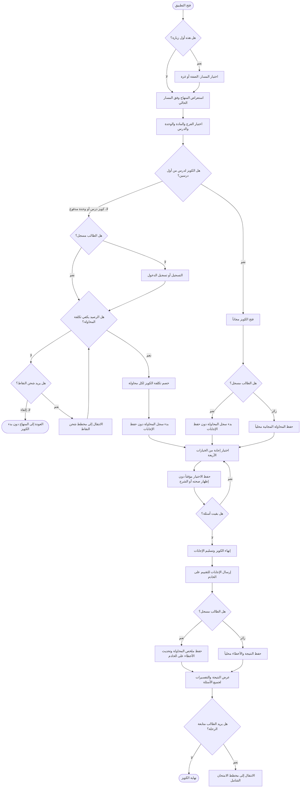
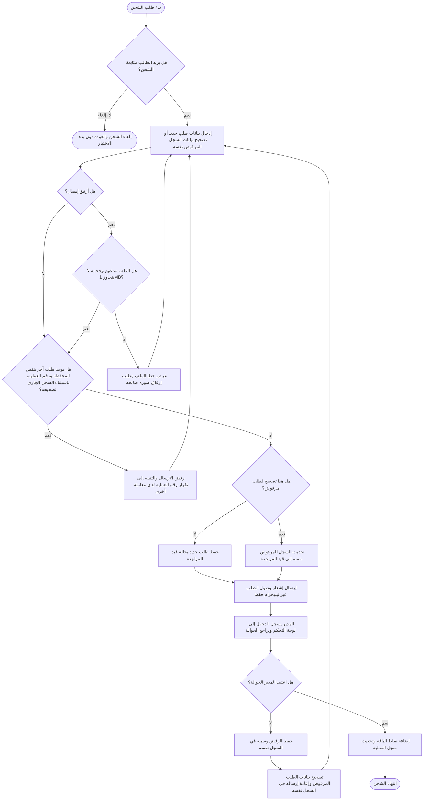
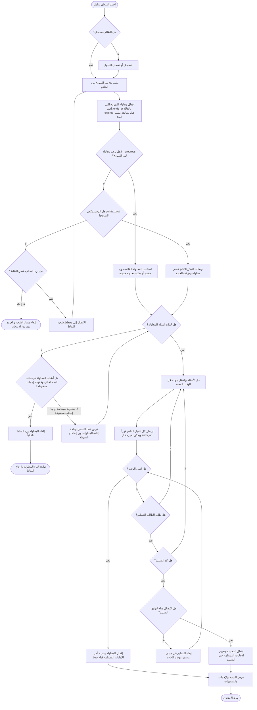

# تدفق المستخدم الرئيسي — تجربة التدريب ثم فتح امتحان شامل

## الدور الرئيسي

طالب التوجيهي، كزائر تجريبي في بداية الرحلة ثم كطالب مسجل عند طلب اختبار مدفوع. يشارك مدير النظام في مراجعة طلب الشحن واعتماده أو رفضه.

## هدف التدفق

تمكين الطالب من اختيار مساره التعليمي، تجربة كويز درس مجاني، ثم التسجيل وحل كويز درس أو وحدة مدفوع أو امتحان شامل عند توفر الرصيد. في جميع الاختبارات لا يظهر التصحيح أثناء الحل؛ تُعرض النتيجة والتفسيرات بعد إنهاء المحاولة.

## تحليل المتطلبات المؤكدة

- **المستخدمون والأدوار:** زائر تجريبي، طالب مسجل، مدير النظام/مدخل المحتوى. ولي الأمر ضمن المستخدمين المستهدفين لتمويل الطالب ومتابعة علاماته، لكنه ليس طرفاً في تدفق MVP المختار.
- **الميزات ذات الصلة:** تخصيص المسار الإقليمي، فهرس المنهاج، كويز التدريب، التسجيل، محفظة النقاط والشحن اليدوي، مراجعة الأدمن، والامتحان الشامل الموقوت.
- **هدف الطالب:** تجربة الأسئلة والشروحات مجاناً، ثم التدرب في امتحان شامل يحاكي الامتحان الوزاري.
- **الدخول والخروج:** يبدأ التدفق عند فتح التطبيق. يمكن أن ينتهي بعد تجربة الكويز المجاني؛ وإذا اختار الطالب متابعة الرحلة المدفوعة، ينتهي بعد تسليم الامتحان وعرض النتيجة. مسار النتيجة مدعوم بمعيار القبول AC-002.
- **الإجراءات:** اختيار المسار والمنهاج، فتح كويز، التسجيل عند الحاجة، فحص الرصيد وخصم السعر لكل محاولة مدفوعة وحفظ ملخصها، اختيار وسيلة الشحن وإدخال بيانات الحوالة، مراجعة المدير من لوحة التحكم، بدء الامتحان أو استئناف محاولته النشطة، وحفظ إجابات الامتحان وتسليمها.
- **التحقق:** التحقق من تسجيل الطالب للاختبارات المدفوعة، كفاية الرصيد، عدم وجود محاولة نشطة سابقة للنموذج قبل إنشاء محاولة امتحان جديدة، عدم تكرار مفتاح (المحفظة + رقم العملية)، وصحة/حجم ملف الإيصال إن أُرفق. تُنفّذ عمليات الخصم والدرجات على الخادم.
- **النتائج:** لا يظهر تصحيح أو تفسير قبل إنهاء الاختبار. عند إنهاء الكويز، يقيّم الخادم الإجابات دون حفظها مفردة؛ يحفظ ملخص الطالب المسجل ويحدّث دفتر أخطائه، بينما يحفظ الزائر نتيجته وأخطاءه محلياً. بعد التقييم تُعرض النتيجة والتفسيرات. اعتماد الحوالة يضيف نقاطها؛ ورفضها يعرض السبب ويسمح بتعديل السجل نفسه وإعادة إرساله.

## مخططات Mermaid

قُسّم التدفق لتسهيل قراءته. عند الانتقال بين المخططات، يبدأ كل مخطط من النقطة الموضحة في عنوانه.

### 1. تجربة كويز التدريب

### 2. شحن رصيد النقاط

يبدأ هذا المخطط عندما يختار الطالب الشحن، مثلًا بعد ظهور تنبيه عدم كفاية الرصيد.

### 3. الامتحان الشامل الموقوت

يبدأ هذا المخطط عند اختيار امتحان شامل. إذا لم يكف الرصيد، يمكن متابعة مخطط الشحن أو إلغاؤه. عند وجود محاولة نشطة للنموذج نفسه، يستأنفها النظام دون خصم.

## شرح التدفق بالعربية

### الرحلة الرئيسية

يفتح الطالب التطبيق ويختار المسار الإقليمي في أول زيارة، ثم يستعرض المنهاج ويختار الفرع والمادة والوحدة والدرس. أول درسين في ترتيب كل وحدة مجانيان. تتطلب الكويزات المدفوعة التسجيل ورصيداً كافياً؛ يخصم الخادم التكلفة المحددة عند بدء كل محاولة ويحفظها. تحفظ محاولات الزائر المجانية محلياً.

إذا لم يكف الرصيد، يمكن للطالب بدء طلب شحن أو إلغاء المسار والعودة دون بدء الاختبار. يرسل النظام إشعاراً بوصول طلب الشحن عبر تيليجرام فقط. يراجع المدير الطلب بعد تسجيل الدخول إلى لوحة التحكم. إذا رفضه، يصحح الطالب بيانات السجل المرفوض نفسه ويعيد إرساله مع الحفاظ على معرّفه؛ وإذا اعتمده المدير، تضاف النقاط.

قبل معالجة طلب بدء امتحان شامل، يقفل الخادم أولاً محاولة هذا الطالب لهذا النموذج إذا بلغت `ends_at` بالحالة `expired`، ثم يبحث عن محاولة `in_progress` للنموذج نفسه لاستئنافها دون إنشاء محاولة جديدة أو خصم نقاط مرة أخرى. إذا لم توجد محاولة نشطة، يخصم الخادم `points_cost` للنموذج وينشئ المحاولة. عند فشل تحميل الأسئلة، لا تلغى ولا تُسترد النقاط إلا إذا أُنشئت المحاولة في طلب البدء الحالي ولم تكن لها إجابات محفوظة؛ أما المحاولة المستأنفة فيعرض لها خطأ تحميل وتتاح إعادة المحاولة دون إلغاء أو استرداد.

يحفظ الخادم ملخص محاولة الكويز فقط ولا يحفظ إجاباتها المفردة. وفي الامتحان الشامل يحفظ الخادم كل اختيار فور استلامه؛ يمكن للطالب تغيير إجابته قبل `ends_at`، ويُحتسب آخر اختيار وصل قبل الموعد. يتطلب التسليم اليدوي تأكيد الطالب واتصالاً لتوثيقه؛ إذا لم يتوفر الاتصال، يبقى التسليم غير موثق ويستمر مؤقت الخادم. عند `ends_at` يقفل الخادم المحاولة بالحالة `expired` قبل تقييم أي طلب بدء جديد، ثم يقيّم الإجابات المقبولة المستلمة قبله وتُحتسب الأسئلة الأخرى بصفر.

### نقاط القرار

- **أول زيارة؟** اختيار المسار الإقليمي إلزامي عند الدخول الأول. في الزيارات التالية يظهر المنهاج وفق المسار الحالي، ويمكن تبديله من التطبيق.
- **هل الكويز مجاني؟** أول درسين في ترتيب الوحدة مجانيان؛ مجانية الدرس مشتقة من الترتيب ولا تخزن كحقل.
- **هل الطالب مسجل ورصيده كافٍ؟** كويز الدرس المدفوع وكويز الوحدة والامتحان الشامل تتطلب التسجيل ورصيداً يغطي التكلفة. يخصم كويز الدرس غير المجاني أو الوحدة لكل محاولة؛ والامتحان يكلف `points_cost` للنموذج.
- **هل توجد محاولة امتحان نشطة؟** يستأنف الطالب المحاولة القائمة للنموذج نفسه دون خصم أو إنشاء محاولة أخرى.
- **هل بيانات الشحن صالحة وغير مكررة؟** الإيصال اختياري وبحد أقصى 1MB. يمنع النظام إعادة إرسال رقم العملية نفسه للمحفظة نفسها.
- **هل اعتمد المدير الحوالة؟** يراجعها بعد تسجيل الدخول إلى لوحة التحكم؛ تيليجرام للإشعار فقط. الاعتماد يضيف رصيد الباقة، والرفض يعرض سببه ويسمح بتصحيح السجل نفسه وإعادة إرساله بعد إعادة التحقق من الإيصال إن أُرفق ومن عدم تكرار رقم العملية مع معاملة أخرى.
- **هل انتهى الامتحان أو طلب الطالب التسليم؟** عند التسليم المؤكد أو بلوغ `ends_at` يقفل الامتحان؛ وتُحتسب آخر الإجابات المستلمة قبل الموعد، وما عداها بصفر.
- **هل الاتصال متاح وقت التسليم؟** حسب حالة الحافة EC-001، لا يُقفل الامتحان عند الضغط على التسليم دون اتصال؛ ينتظر استعادة الاتصال لتوثيق التسليم على الخادم.

### سيناريوهات النجاح

- الزائر يحل كويز أحد أول درسين دون إنشاء حساب أو خصم نقاط؛ لا يرى التصحيح أثناء الحل، ثم تظهر النتيجة والتفسيرات بعد الإنهاء.
- بعد تقييم المحاولة، تُحدّث الإجابات الخاطئة دفتر الأخطاء دون إنشاء سجل مكرر للسؤال.
- الأدمن يطابق الحوالة ويعتمدها؛ يضاف رصيد الباقة، ويستطيع الطالب بدء الاختبار المدفوع.
- الطالب يسلم الامتحان أو ينتهي وقته، فتظهر النتيجة والتفسيرات وتُحدّث سجلاته وإحصائياته.

### سيناريوهات الخطأ

- **رصيد غير كافٍ:** تظهر رسالة توضح الرصيد الحالي والتكلفة المطلوبة مع توجيه لشاشة الشحن.
- **رقم حوالة مكرر:** يُرفض الطلب ويُطلب التحقق من رقم العملية.
- **حوالة مرفوضة:** تعرض المحفظة سبب الرفض، مع إمكانية تصحيح بيانات السجل نفسه وإعادة إرساله.
- **إيصال غير مدعوم أو أكبر من 1MB:** يظهر تنبيه الملف، ويمكن إعادة الإرفاق. الإيصال اختياري.
- **تعذر تقييم الكويز بعد الإنهاء:** تبقى الاختيارات محفوظة مؤقتاً ويُطلب من الطالب إعادة إرسالها؛ لا تظهر نتيجة غير مؤكدة.
- **تعذر الاتصال بالخادم:** يذكر PRD رسالة لإعادة المحاولة تلقائياً. لا تدخل إجابة امتحان لم تصل إلى الخادم قبل `ends_at` في النتيجة.
- **الاتصال منقطع أثناء تسليم الامتحان:** يبقى الامتحان غير مقفل إلى حين عودة الاتصال وتوثيق التسليم.

### المسارات البديلة

- يمكن للزائر إنهاء الرحلة بعد الكويز المجاني، أو إنشاء حساب للمتابعة إلى الاختبارات المدفوعة.
- قد يختار الطالب مسار الضفة أو غزة؛ المنهاج المعروض يختلف، فيما تبقى تكلفة النقاط موحدة.
- يمكن تقديم الشحن بأي من Jawwal Pay أو PalPay أو بنك فلسطين/Reflect؛ النقاط المضافة تعتمد على الباقة المعتمدة.
- إذا رفض المدير الحوالة، يصحح الطالب بيانات المعاملة نفسها ويعيد إرسالها. لم تُحدد نتيجة خاصة لتجاوز هدف مراجعة طلب الشحن.

## قواعد الأعمال ذات الصلة

1. أول درسين من كل وحدة مجانيان (0 نقطة).
2. كويز الدرس 10 نقاط، وكويز الوحدة 20 نقطة، والامتحان الشامل 30 نقطة افتراضياً وفق بيانات PRD.
3. باقات الشحن المذكورة: 10 شيكل = 100 نقطة، 25 شيكل = 300 نقطة، 50 شيكل = 700 نقطة.
4. الدفع لا يتم عبر تكامل آلي مع بوابة بنكية في MVP؛ يراجع الأدمن الحوالة يدوياً، ولا تضاف النقاط قبل المطابقة البشرية.
5. مفتاح الحوالة `(المحفظة + رقم العملية)` فريد لمنع التكرار.
6. لا يكشف كويز التدريب صحة الإجابة أو شرحها أثناء الحل. تُجمع الاختيارات حتى الإنهاء، ثم يقيّمها الخادم للمسجل والزائر؛ تُعرض النتيجة والتفسيرات بعد ذلك، ويُحدّث دفتر الأخطاء.
7. يحفظ الخادم ملخص محاولة الطالب المسجل في `quiz_attempts` فقط؛ يتلقى اختياراته عند الإنهاء لتقييمها دون تخزين الإجابات المفردة. تُخصم تكلفة الكويز المدفوع لكل محاولة، ويحفظ الزائر نتيجته وأخطاءه محلياً.
8. يستأنف بدء الامتحان محاولة `in_progress` الموجودة للنموذج نفسه، ولا ينشئ محاولة أو يخصم نقاطاً إضافية.
9. يحفظ الخادم اختيار إجابة الامتحان فور استلامه؛ يسمح بتغييره قبل `ends_at` ويحتسب آخر اختيار استلمه قبل الموعد فقط. محاولة الكويز المسجلة تحفظ ملخص المحاولة فقط، ولا تحفظ إجابات الكويز المفردة على الخادم.
10. يعتمد الامتحان الشامل مؤقت خادم صارماً. التسليم اليدوي يتطلب تأكيداً، والانتهاء التلقائي يحتسب الإجابات غير المستلمة قبل الموعد بصفر.
11. عند فشل تحميل الأسئلة، تلغى وتُسترد النقاط فقط لمحاولة أُنشئت في طلب البدء الحالي ولا تحتوي إجابات محفوظة؛ فشل التحميل لمحاولة مستأنفة أو لمحاولة لها إجابات محفوظة لا يلغيها ولا يسترد نقاطها، ويتيح إعادة المحاولة.
12. يراجع المدير طلب الشحن بعد تسجيل الدخول إلى لوحة التحكم؛ تيليجرام للإشعار فقط. طلب الشحن المرفوض يُصحح ويُعاد إرساله في السجل نفسه.
13. يتطلب بدء الاختبارات وخصم النقاط ومزامنة النتائج اتصالاً بالإنترنت.
14. تخصيص المسار الإقليمي مطلوب عند أول دخول؛ محتوى الضفة وغزة منفصل، وتكلفة النقاط موحدة.
15. عند معالجة طلب بدء جديد، يقفل الخادم أولاً محاولة الطالب نفسها إذا بلغت `ends_at` بالحالة `expired`؛ لذلك لا تمنع المحاولة المنتهية لهذا النموذج إنشاء محاولة جديدة.
16. عند تصحيح طلب شحن مرفوض وإعادة إرساله في السجل نفسه، يعاد التحقق من نوع الإيصال وحجمه إن أُرفق ومن عدم وجود معاملة أخرى بالمفتاح `(payment_method, transaction_id)` قبل إعادته إلى `pending`.

## أسئلة مفتوحة ونقاط غير محسومة

1. ما الإجراء التفصيلي إذا لم يراجع المدير طلب الشحن ضمن هدف الـ 15 دقيقة؟
2. هل يمكن للطالب إلغاء طلب الشحن قبل مراجعته؟ أُدرجت سياسة الإلغاء والاسترداد كسؤال مفتوح.
3. ما أرقام حسابات الدفع الرسمية التي ستعرض للطالب؟ لم تُحدد بعد.
4. كيفية استعادة جلسة كويز التدريب إذا انقطع الإنترنت أثناء الحل غير محددة بما يكفي.
5. آلية مواصلة الطالب بعد انتهاء تجربة الدرس المجاني غير موضحة بالتفصيل؛ كما أن سلوك دمج بيانات الزائر عند التسجيل يختلف بحسب وجود حساب قائم.
